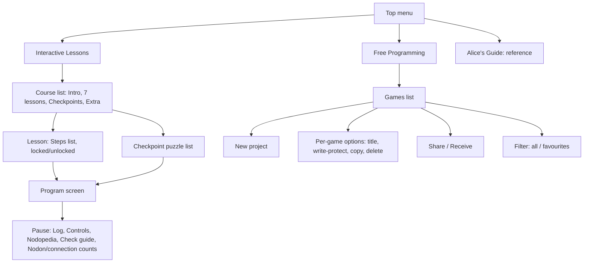

# GBG content, pedagogy, UX and audio study (design input, not a clone spec)

Date: 2026-10-27 · Source: `D:\gbg\game-builder-garage\` (read-only dump; all paths below are relative to it unless absolute) · Scope: content, pedagogy, UX flow, audio, localization
Tags: **[V]** verified in dump data (file cited) · **[X]** external source · **[I]** inference · **[U]** unresolved
No text or audio reused. English text is paraphrased; quotes limited to 1-3 words.

---

## 0. TL;DR (ranked)

1. **Curriculum = 1 intro + 7 "build a known game" lessons (59 steps) + checkpoint puzzles after each lesson + free mode.** [V] Step is the teaching unit. Each step saves a cumulative program snapshot. New node types per step: 0-8, with spikes at a few steps.
2. **Teaching = scripted voice/text per step + exact values + highlighted UI labels + per-node persona lines + per-node hints.** [V] Errors are prevented by hard caps, scoped puzzle edits and confirmations, more than by error messages.
3. **Checkpoints are constrained-edit puzzles that end in a single "Puzzle Clear" sink node.** [V] Only designated edits are allowed. This is the assessment mechanism.
4. **Two top modes: Interactive Lessons (guided, gated) and Free Programming (blank project).** [V] Guide reference (Alice's Guide) is reachable from every menu and from the pause menu.
5. **Sound is a creative tool.** [V] 190 named SFX (11 groups, once/loop), 11 BGM themes x 4 parts x 3 timbres, 15 instruments, a 12-key note picker, max 4 BGM Nodon. Nodon voice = 4,041 clips, ~72% of all 5,592 WAV.
6. **Localization: 13 locale folders (10 languages + regional variants), 13,392 messages per locale, ~174k total. No Vietnamese.** [V] Official store lists the same 13 languages. [X]
7. **Recommendation for our builder:** hybrid onboarding (short scripted first win, 2-3 constrained-edit checkpoints, free mode early, per-node help). Do not build a 59-step course first. Authoring and translation cost is the real cost, not the engine. See section 8.

---

## 1. Corpus map and caveats

| Asset | Path | Count | Note |
|---|---|---|---|
| Lesson programs | `logic/nodon-programs/Pack/Cvr.pack.d/Param/Lesson/` | 192 json | 8 families (section 2) |
| Checkpoint puzzles | `.../Param/Puzzle/` | 82 json | median 20 nodes (lessons median 9, guidebook 4) |
| Guidebook demos | `.../Param/Guidebook/` | 135 json | 36 topics |
| Endings / Nodon catalogue | `.../Param/Ending/` (+ mirror `logic/nodon-programs/Param/Ending/`) | 28 json | 27 numbered sheets + 1 full sheet; 0 connections each |
| All-Nodon sheet | `logic/nodon-programs/Param/Tpb_Lgc_AllNoden.json` | 1 | |
| Index | `logic/nodon-programs/nodon-programs-index.json` | 472 entries | 5 marked empty; field labels + node-type usage |
| Lesson/puzzle/guide text (EN) | `assets/text/EUen/Tpb_{Lesson,Puzzle,Guidebook,Sequence,LogiCon,Common}/` | 160 files, 13,392 msgs | |
| Text, all locales | `assets/text/<locale>/` | 13 folders x 160 files | `by-label/` = merged view |
| Learn media | `data/files/Learn/` | 16 webm, 23 jpg | section 2.6 |
| Audio | `assets/audio/Resource/` | 5,592 wav, 226 folders | `_carved/` holds 5,444 raw bfwav (not converted) |
| Audio index | `assets/audio/audio-index.json` | wav_ok 5,592, fstp_skipped 148 | |

Caveats that matter for this study:
- **[V]** Program JSON carries English node labels (`label.en`), so node names and step structure are read directly, not from CRC-keyed BYML fields. Node property meanings still follow the sibling logic study.
- **[I]** Program-to-step mapping is inferred. Rule that fits every checked lesson: `program NN+1` = text step `NN`. Evidence: the step titled "player controls" introduces Button/Stick/Person in program 01. Finish/padding/system suffixes are inferred from names and text.
- **[U]** Program files are program state snapshots; the editor's actual load behaviour was not observed (no runtime).
- Index says 472 entries; 437 program files under `Pack/` + 28 mirror + 1 all-Nodon sheet = 466 files. Difference is the 5 empty entries plus index bookkeeping. [I]

---

## 2. Curriculum

### 2.1 Unit map (order of play)

[V] Intro, lesson names, step titles and course lengths come from `assets/text/EUen/Tpb_Lesson/LessonName.json`, `StepName.json`, `Tpb_Sequence/Sequence_Intro_Course_00.json`, and `Tpb_LogiCon`/`Lyt_Common` course-menu strings. Family-to-lesson mapping is [V] for L1, L4, L6, L7 (text names the game and type) and [I] for L2, L3, L5 (name match).

| # | In-game lesson (paraphrased) | Game built | Family (files) | Steps | Checkpoint after | Course length label [V] |
|---|---|---|---|---|---|---|
| 0 | Programming 101 | Fix broken jump: wire button to person | `Lesson_Intro` (1, 30 nodes) | 1 | Intro checkpoint (before L1) | n/a |
| 1 | Tag Showdown | tag chase game | Chase (7 files, 26 programs) | 7 | CP1 | ~40 min |
| 2 | On A Roll | tilt-controlled rolling ball, uses Joy-Con motion | BallRoll (8 files) | 8 (+ "Gyro" mini) | CP2 | ~50 min |
| 3 | Alien Blaster | auto-scroll shooter | Shooting (10 files) | 10 | CP3 | ~70 min |
| 4 | Risky Run | side-scrolling run/jump/punch | 2DAction (10 files) | 10 | CP4 | ~80 min |
| 5 | Mystery Room | 3D puzzle room with hidden treasure | SecretRoom (9 files) | 9 | CP5 | ~80 min |
| 6 | Thrill Racer | player vs computer car | CarRace (8 files) | 8 | CP6 | ~60 min |
| 7 | Super Person World | 3D action with gimmicks and branching | 3DAction (7 steps, 13 text files) | 7 | Extra checkpoint | ~90 min |

- [V] Total 59 steps (matches 59 StepName entries and 59 `Tpb_VO_Step_Lesson_L-S` voice clips).
- [V] Course length labels sum to ~470 min (~7.8 h). External preview estimate is 8-10 h. [X: Nintendo Life preview snippet, unverified full text]
- [I] Length labels map to lessons 1-7 in order.

```mermaid
flowchart LR
  I[Intro: Programming 101] --> CPi[Checkpoint intro]
  CPi --> L1[L1 Tag Showdown] --> C1[CP1] --> L2[L2 On A Roll] --> C2[CP2]
  C2 --> L3[L3 Alien Blaster] --> C3[CP3] --> L4[L4 Risky Run] --> C4[CP4]
  C4 --> L5[L5 Mystery Room] --> C5[CP5] --> L6[L6 Thrill Racer] --> C6[CP6]
  C6 --> L7[L7 Super Person World] --> X[Extra CP]
```

### 2.2 Step-by-step introduction of Nodon (per lesson)

Format: step title (paraphrased) = program size at end of step (nodes) and **new Nodon types introduced**. "-" = no new type. Types shortened (drop "Node"; "Obj" = Object-type Nodon; "Cam" = camera; "Sens" = sensor).
Source: diffs of consecutive main-line program files in `Pack/Cvr.pack.d/Param/Lesson/` [V]; step titles [V]; pairing rule [I].

**L1 Tag Showdown (Chase)**
| Step | Title | Nodes | New types |
|---|---|---|---|
| 0 | Player controls | 3 | Button, Stick, Person |
| 1 | Floor and walls | 7 | Game Screen cam, Obj |
| 2 | Platforms | 15 | - |
| 3 | Tussling with a tagger | 18 | - |
| 4 | The balls (launcher) | 22 | Launch (generator) |
| 5 | Automatic retry | 25 | Break counter, Retry, Timer |
| 6 | Finishing touches | - | (no program file) |

**L2 On A Roll (BallRoll)**
| Step | Title | Nodes | New types |
|---|---|---|---|
| mini | Gyro intro | 1 | (tilt Nodon) |
| 0 | Overhead view | 6 | Game Screen cam, Fancy obj, Obj |
| 1 | Slanting spheres | 9 | Tilt (axis angle), Move obj |
| 2 | Improving the level | 16 | - |
| 3 | Counting apples | 19 | Break counter, Score obj, Counter |
| 4 | Win condition | 24 | Calculator, Comparison, Constant, Effect, Play Sound |
| 5 | User-friendly experience | 28 | Text obj, Retry, Timer |
| 6 | Teleporting | 38 | Wormhole in/out |
| 7 | Finishing touches | - | - |

**L3 Alien Blaster (Shooting)**
| Step | Title | Nodes | New types |
|---|---|---|---|
| 0 | Unidentified firing object | 5 | Game Screen cam, Obj, UFO, Stick |
| 1 | Cannon calibrations | 9 | Button, Constant, Launch, Gravity |
| 2 | Building the level | 18 | Fancy obj, World, Break counter, Retry, Timer |
| 3 | Scrolling the screen | 34 | Map, Counter |
| 4 | Controlling the scrolling | 35 | NOT |
| 5 | Spinning obstacles | 48 | Rotating obj |
| 6 | Spinning enemies | 60 | - |
| 7 | Making a goal | 68 | Text obj, Effect, Touch sensor, Play Sound |
| 8 | Score display, perfect score | 80 | AND, Comparison, Teleport obj in/out, Number obj |
| 9 | Finishing touches | - | - |

**L4 Risky Run (2DAction)**
| Step | Title | Nodes | New types |
|---|---|---|---|
| 0 | Camera tracks player | 6 | Button, Game Screen cam, World, Person, Obj, Stick |
| 1 | Know (and create) your enemy | 11 | Fancy obj, Break counter, Retry, Timer |
| 2 | Making plummets perilous | 15 | Comparison, Constant, Destroy obj, Position sensor |
| 3 | See-saw | 18 | Hinge connector |
| 4 | Movable crate | 24 | Slide connector |
| 5 | Moving platforms | 32 | Teleport obj in/out, Counter |
| 6 | Power-ups from items | 48 | AND, Flag, Text obj, Wormhole in/out |
| 7 | Building a boss | 58 | NOT, Broken sensor, Generator, Play Sound |
| 8 | Setting a goal | 66 | Effect, Touch sensor |
| 9 | Finishing touches | - | - |

**L5 Mystery Room (SecretRoom)**
| Step | Title | Nodes | New types |
|---|---|---|---|
| 0 | Peeking into 3D | 7 | Button, Person, Obj, TPS cam, Stick |
| 1 | Treasure room | 20 | World |
| 2 | Hidden doors, contraptions | 29 | Fancy obj, Slide connector, Number obj |
| 3 | Breaking open the box | 38 | **8 new**: AND, Comparison, Constant, Destroy obj, Effect, Touch sensor, Counter, Play Sound |
| 4 | Secret code | 43 | - |
| 5 | Walls have secrets | 54 | Wormhole in/out |
| 6 | Opening hidden door | 65 | Map |
| 7 | Sound effects | 71 | NOT |
| 8 | Hidden treasure | - | - |

**L6 Thrill Racer (CarRace)**
| Step | Title | Nodes | New types |
|---|---|---|---|
| 0 | First wheels | 7 | Button, Calculator, Car, World, TPS cam, Stick |
| 1 | Finish line | 14 | Constant, Effect, Retry, Obj, Touch sensor, Timer |
| 2 | Finding the winner | 30 | AND, Comment, Flag, NOT, Fancy obj, Wormhole in/out |
| 3 | Race course | 43 | - |
| 4 | Autonomous car | 48 | Number obj |
| 5 | 3-2-1 go | 56 | On Start |
| 6 | Teleporting | 58 | Teleport obj in/out |
| 7 | Finishing touches | - | - |

**L7 Super Person World (3DAction)** — the only lesson with branching program states.
| Step | Title | Nodes | New types / branch |
|---|---|---|---|
| 0 | Player controls (reprise) | 9 | Button, World, Person, Obj, TPS cam, Stick |
| 1 | Plummets (reprise) | 22 | Comparison, Constant, Destroy obj, Break counter, Position sensor, Retry, Timer |
| 2 | First gimmick | finish 29 or 31 | **choice a / b** (moving platform vs hazard bar) |
| 3 | Second gimmick | finish 43-58 | **two choices** (4 finish states) |
| 4 | Forging a foe | finish 53-74 | **three choices** (8 finish states) |
| 5 | Making the goal | finish 58-79 | 8 finish states |
| 6 | First step in the journey | - | final |

- [V] 22 finish snapshots + 14 "padding" snapshots (unwired scenery objects, inferred) for 3DAction.
- [V] Text supports player choice: prompts like "which one they'd prefer?" and reactions like "good choice". Lines in `Tpb_Lesson/Lesson_3DAction_02.json`, `_03.json`, `_04.json`; `Lesson_SecretRoom_08.json` ("interesting choices").
- [I] Finish names encode choice bits (aa/ab/ba/bb, aaa..bbb). Step numbers in finish names = step that closes.

### 2.3 Ramp pattern (what the data shows)

- [V] Main-line programs are cumulative: no node type disappears between consecutive steps (checked on 2DAction, SecretRoom, Chase).
- [V] Size grows steadily: L1 3 -> 25 nodes in 6 steps; L4 6 -> 66 in 9 steps; L7 9 -> ~80 in branch finishes.
- [I] Novelty is front-loaded per lesson (steps 0-1 introduce 3-6 types), then a "teach then reuse" rhythm: zero-new steps sit in the middle (Chase 2-3, BallRoll 2, CarRace 3, Shooting 6). Spikes come at one "combo" step per lesson (SecretRoom step 3: 8 types; BallRoll step 4: 5 types; 2DAction step 6: 5 types).
- [I] Each lesson's last step is "Finishing touches" with no new program, i.e. polish on existing parts.

### 2.4 Checkpoints (puzzles)

- [V] Eight puzzle sets: intro + CP1-CP6 + Extra. Sequence strings: intro checkpoint before lesson 1; each later checkpoint starts after finishing the previous lesson.
- [V] Each checkpoint has five puzzles (stated in `Tpb_Sequence/Sequence_PuzzleStart_01.json`).
- [V] 82 puzzle programs and 81 puzzle titles (`Tpb_Puzzle/PuzzleName.json`). Titles are concept-style (for example "Stopping with NOT", "The Meaning of AND", "Waking up the Flag Nodon").
- [V] A "Puzzle Clear" node appears in 81 puzzle programs. It is the win sink.
- [I] Puzzle-to-checkpoint mapping not recovered. The 82 programs exceed 5 x 6 = 30 main puzzles; the rest are likely in Extra [U].
- [V] Puzzle rules are explicit: "you can't just edit whatever you feel like", and only the named Nodon connection is allowed (`Tpb_Puzzle/Puzzle_Intro.json`).
- [V] Stuck-player flow (`Tpb_Puzzle/Puzzle_Common.json`): offer a hint, yes/no to leave the puzzle to read the guide, then a "solo" encouragement and a reminder that the guide is always one pause away. Trigger threshold not in text [U].

### 2.5 Role of checkpoints (verdict)

- Assessment (pass/fail by clear), not instruction. [V]
- Spaced retrieval of earlier lessons: Intro checkpoint covers basics; the later ones reuse L1-L6 concepts. [I]
- "Skipped" state exists for puzzles (`Tpb_LogiCon`/`Lyt_Common` "Skipped"). [V]

### 2.6 Learn media inventory (`data/files/Learn/`)

| Folder / file group | Count | Covers [I from names; not viewed] |
|---|---|---|
| `Tpb_CourseLessonMov_00..07.webm` | 8 | One course movie per unit (00 = intro, 01-07 = lessons 1-7) |
| `Tpb_CoursePuzzleMov_00.webm` | 1 | Checkpoint explainer |
| `Tpb_Lesson_<Family>_Game.webm` (+ `Tpb_Lesson_Chase.webm`) | 7 | Gameplay footage of each finished game |
| `Guidebook_AxisAngle/` | 8 jpg | Tilt/angle demos (punch, X/Y/Z) |
| `Guidebook_Connection/` | 4 jpg | Connection demos (tuna, UFO) |
| `Guidebook_RotateRigid/` | 2 jpg | Rotation demos |
| `Guidebook_ViewChange/` | 6 jpg | Camera view demos |
| `Lesson_CarRace/`, `Lesson_Chase/` | 3 jpg | Autopilot and play frames |

---

## 3. Teaching techniques

### 3.1 Step script anatomy [V: sampled `Tpb_Lesson/Lesson_2DAction_00.json`, `Lesson_3DAction_02a.json`]

Each step is ~50-150 short messages per lesson (1,044-1,451 per family). Order inside a step:
1. Narrator frame: reminder of what is done so far, what changes now.
2. Micro-instructions, one action per line: "Open X settings", "select Y", "set Z to 0.50".
3. Exact values and exact labels. UI labels are wrapped in highlight tags so the player finds the same word on screen.
4. Placement cues tied to the screen: "blue frame", "output port", "copy this Nodon again", "make it smaller".
5. Reaction line on success ("great job", "good choice").

Consequence: most steps leave almost no decision to the player. Choice appears only at designated branch points (L7) and in free mode.

### 3.2 Input-aware instructions [V: `Tpb_Lesson/Lesson_Intro.json` lines 031 variants]

Same wiring instruction exists in 4 variants: touch screen, control-stick pointer, Joy-Con (tilt) pointer, and a mouse-button variant. Instruction text names the input the player is using. [I] The mouse variant likely covers a USB-mouse input mode; not verified.

### 3.3 Characters

| Character | Role | Style [V samples] |
|---|---|---|
| Bob | Lesson host, "excitable" | Loud, enthusiastic, jokey; introduces himself and the lesson |
| Alice | Guide and checkpoint host; "Alice's Guide" is the reference | Calm, dry, self-aware; corrects Bob's over-enthusiasm; asks the player to check understanding |
| Nodon (87 voice sets) | Each Nodon type is a character | Varies by function (table 3.4) |

- [V] Alice and Bob each have 31 voice clips (`assets/audio/Resource/Tpb_IndicatorAliceXLinkActor`, `...BobXLinkActor`).
- [V] Alice explicitly separates herself from Bob ("I look similar, but I'm Alice"). Good to note for a distinct-host design.
- [V] Player name inserted via placeholder tag (`[tag 2:1]`).
- [V] Intro is a fiction wrapper: the player is shown a broken game, then fixes it with the first wire. Guide tells the player the game "is still under construction". Frames the lesson as a repair task.

### 3.4 Nodon personas by function [V: `Tpb_Common/NodeChat.json`, 86 lines; paraphrased]

| Function group | Persona hook (paraphrased) | Examples |
|---|---|---|
| Input (button, stick, touch, shake) | Hype, encourages energy | Button shouts; Shake yells; stick told to "waggle" |
| Input (touch, tilt, face-up) | Calm, zen, teasing | Touch asks to be gentle; tilt Nodon jokes about yoga |
| Logic | Character matches the logic | Flag is sleepy; Timer nags about breaks; Trigger says "shh, need to focus"; NOT jokes about itself |
| Math | Dry or self-deprecating | Trig Nodon says it is "hard to follow" |
| Counter | All-caps shouting | Counter repeats "try again" |
| Calculator | Parody of an over-eager office assistant [I] | Calculator opens with an all-caps "it seems you are trying to..." joke |
| Wormhole in/out | Radio operator | "Over" protocol |
| Objects | Warm, cheeky | Fancy object is flirtatious; launch Nodon is loud |
| Sensors | Cheerful, reactive | Touch sensor startled; grab sensor playful |
| Camera | Photographer | "Give us a smile" |

- [V] Each Nodon has ~47 voice clips in a fixed taxonomy. Details in section 5.3.
- [I] The "persona = function" mapping is a mnemonic: the personality reinforces what the node does.
- [V] Dialect and accents differ per character (regional British and Scots-like phrasing in some lines). Localized separately (German text uses its own voice). This is a major localization cost (section 6).

### 3.5 Error prevention

Prevention beats messaging. Observed mechanisms [V unless noted]:

| Mechanism | Evidence | Note |
|---|---|---|
| Hard caps with explanatory dialog | `Dialog_Max*` strings in `assets/text/EUen/Tpb_LogiCon/LogiConTpb_Main.json` (71 Dialog keys across Lyt_Common and LogiCon) | 512 Nodon; 1024 connections; 24 Comment; 4 BGM Nodon; 8 Person / Car / UFO / Hand; 32 Fancy; 128 Texture; 1 World; 1 Camera; 26 teleport IDs (A-Z) |
| Incompatible combinations blocked | "cannot be called simultaneously" dialogs | Two cameras, or a camera with an advanced camera |
| Per-node hints | 93 hint bodies covering 80 node types; 8 FAQ-style titles ("What does AND mean?") | Shown in pause menu "Check Guide" |
| Scoped editing in checkpoints | `Puzzle_Intro` | Only the named edit is allowed |
| Destructive confirmations | "If you quit now you lose progress", "Save and quit", "Start this step overwrites your saved game" | Three-way choice for in-progress lessons |
| Write-protect and copy | "Please make a copy of this game to edit it" | Protects shared/received games |
| Warnings with recovery | "Joy-Con needs recalibration", "too many objects overlapping, resolving" | Warning + automatic resolution |
| Stuck-player offer | Puzzle hint flow | Opt-in help, respects "solo" choice |

### 3.6 Guided vs free programming

| Aspect | Interactive Lessons (guided) | Free Programming (sandbox) |
|---|---|---|
| Start state | Pre-built partial program per step | "start with nothing" [V `Tpb_Sequence/Sequence_MyGame_01.json`] |
| Progression | Linear; steps locked until earlier ones done; can re-enter a finished step and overwrite | None |
| Instruction | Step script (3.1) | Guide and per-node hints only |
| Assessment | Checkpoint puzzles | None; user judges |
| Output | Game that can go "gold" (finished) and is saved to the games list | Game list (new/edit/copy/delete) |
| Unlock | [X: GameSpot review snippet says free mode unlocks after lesson 1; full text not fetched] | |

- [V] "Going gold" is the completion metaphor; completing a lesson adds it to the games list (`Tpb_Sequence/Sequence_LessonFinish_01.json`).
- [V] Guide reference: 36 topics (`Tpb_Guidebook/`), 135 demo programs, side tabs "Nodon appearing" and "Others" (`Tpb_Common/Lyt_Common.json` `Tpb_GuidebookMenu`).

### 3.7 Meta-learning devices [V unless noted]

- "Reprise" steps (3DAction 0-1) re-run earlier lessons' skills before a new gimmick. [I] Spaced retrieval.
- Milestone event screens: "All Clear", "All Lessons Clear" with a credit-style card.
- Ending: a Nodon catalogue shows every Nodon type in 27 groups (`Ending/Tpb_Ending_00..26`) + one full sheet (84 nodes). [I] Built as a second-pass recap.
- "Extra checkpoint" after lesson 7: "extra-special" puzzles. [V string]

---

## 4. UX and menu structure

### 4.1 Top level [V: `Tpb_Common/Lyt_Common.json` `Tpb_TopMenu`, `Tpb_MyGameMenu`, `Tpb_CourseMenu`, `Tpb_LessonMenu`]

- Lesson Steps list shows Nodon counts and clear state; a "Step" label prefixes each entry.
- Course list shows per-lesson length and clear percentage. Puzzle list shows "Skipped" states.
- Guide reachable from course, lesson, puzzle, free-programming and pause menus. [V]

### 4.2 Program screen (the editor), pause menu

| Pause item (paraphrased) | Purpose |
|---|---|
| Log | Backlog of dialogue; can replay images and movies |
| Controls | Input mode: touch / stick pointer / motion pointer; canvas shortcuts on/off; invert scroll; invert zoom |
| Nodopedia | In-game Nodon reference (separate from the guide) |
| Check guide | Jumps into Alice's Guide (current topic) |
| Counters | Nodon count and connection count |
| End / Return to puzzle / Start again / Restart this step | Exit and reset variants depending on mode |

### 4.3 Editor interaction model [V strings; I for exact gestures]

- **Palette** (top categories, `Tpb_LogiCon` menu keys): Input (touch, motion, state change), Logic (logic, flag/counter/random, calculator, convert, angle), Output (play SFX, play instrument, change world, retry/end/swap, other), Objects (characters, simple, fancy by 4 shape pages, special, moving, rotating, extending, effects, sensors, connections, launch/destroy/attract, teleport), Camera (game screen/camera, advanced, first person), Program layout (edit), Auto, Console.
- **Place**: choose from palette -> node appears on canvas. Some Nodon have a "numpad" entry variant for numeric sliders (for example timer delay). [V]
- **Configure**: each node has a settings sheet with switches (for example "Output timing: On press / While pressed") and sliders with labels. [V]
- **Wire**: drag from an output port to an input port. Ports have short labels ("Input 2", "Amount tilted"), so the port name is visible on the node. [V] Pointer mode depends on the input setting (4.2).
- **Context menu**: copy, delete, lock on/off, delete wire, bind wire. [V SE names; menu labels]
- **Canvas**: pan/zoom, with invert options and optional hardware-button shortcuts. [V]
- **Painting** (textures): pen, brush, eraser, flood fill, colour picker; guide overlays ("3x3 grid", "doughnut", "LED numeral", "car", "UFO") for texture painting. [V]
- **Feedback**: each menu family has a confirm sound (4 families). Audio used as UI confirmation. [V]

### 4.4 Sharing and receiving [V: `Tpb_Sequence/Sequence_Share_*`, `Tpb_Common/Lyt_Common.json`]

| Flow | Path |
|---|---|
| Share online | Requires NSO membership; upload picks the game; title and username become public |
| Share locally | Nearby friends; can require a passcode to receive |
| Receive online | Enter a Game ID or Programmer ID |
| Receive locally | "Locally shared games" list; search again |
| Report | 7 categories (privacy, violence, harassment, hateful, spam, sexual, other) + "not set" |
| Parental notice | Upload flow asks for reading with a parent/guardian |

- [V] Sharing by ID is the primary model (Game ID / Programmer ID). No account browsing mentioned.
- [V] "Swap Game" node + keyword: a program can hand off to another game by keyword. Creative mechanic, not sharing. Lets a game link to another without a menu.

### 4.5 Limits as UX

- [V] Hard caps are presented as dialogs with the reason, not as silent failures (section 3.5). Good pattern to copy.

---

## 5. Audio

### 5.1 Inventory [V: `assets/audio/Resource/` filename prefixes; counts from file scan]

| Category (filename prefix) | WAV | Role |
|---|---|---|
| Nodon voice `Tpb_VO_*` | 4,041 | Per-character lines (5.3). Includes Alice 31, Bob 31, lesson step narration 59 (`Tpb_VO_Step_Lesson_L-S`), puzzle-clear voice |
| Play-SFX library `Tpb_SE_SENode_*` | 698 | Picker SFX (190 named in 11 groups) + pitched violin set + others |
| UI SFX `Tpb_SE_UI_*`, `Tpb_SE_NodeMenu_*`, `Tpb_SE_Noden`, `Tpb_SE_Wire`, `Tpb_SE_OBJ`, `Tpb_SE_BindWire`, `Tpb_SE_Bob` | 319 / 100 / 14 / 14 / 83 / 2 / 7 | Menu confirm, context menu, painting tools, wire events, object events |
| BGM stems `Tpb_BGMNode_NN_*`, `Tpb_BGM_BGMNode_07_*` | 120 | 10 themes x 12 stems (4 parts x 3 variants) |
| BGM streams `Tpb_BGM_*` (in `Stream/`) | 40 | Menu, lesson, puzzle, guidebook, lesson-clear, 12 ambient beds |
| Piano-family pitched `Pno_SE_*` | 38 | Cat, man, woman-type timbres, per note [I] |
| Jingles `Tpb_JGL_*`, `Plz_JGL_*` | 18 | Clear/fail jingles |
| Object/gimmick SFX `Plz_SE_*`, `Plz_Obj*` folders | 72 + 147 | Breaks, cracker, car, UFO, fireworks |
| Other lab/system `Lgc_SE`, `Lab_SE_LEARN`, `Learn_SE`, `Bzk_*`, `Wnd_SE` | ~15 | Learn/logic cues |
| Dev leftovers `test_*`, `rubber_test*`, `paint_test`, `Test_SE_*`, `Tbp_SE_*` | ~40 | Test-named assets shipped in the archive [V] |
| Raw carved `_carved/` | 5,444 bfwav | Not converted; not counted above |

- [V] Total converted: 5,592 WAV (`audio-index.json` wav_ok). Nodon voice is ~72% of files.
- [V] Per-widget UI folders: 95 `UI_*` folders (1-19 files each), used for lesson tiles, dialogs and menu buttons.

### 5.2 Sound as a creative tool

| Feature | Detail [V unless noted] |
|---|---|
| Play SFX Nodon | Picker of 190 named effects in 11 groups: percussion, alarms, machines, collision, funny, system, ambient/nature, animals, voices, SFX, jingles. Once or loop. |
| Play Instrument | 15 timbres (for example piano, guitars, violin, harp, bell, chiptune, muted guitar, and three voice-type timbres). 12-note key picker (C to B with sharps). [I] Key picker is a bitmask. Index confirms u64 bitmask fields exist. |
| BGM Nodon | Theme (11 mood-named themes, including an "ambient" theme) x 4 parts (melody, main accompaniment, sub accompaniment, rhythm) x 3 variants + "silent" per part. Max 4 BGM Nodon per game. |
| Layering model | A game's music is built by choosing up to 4 BGM Nodon, each with a part. Player composes by layering, not by importing audio. [V limit; I on "no import"] |
| Confirm sounds | Distinct confirm cue per editor menu family (input, middle, object, output). |
| Intro promise | Intro states the player picks the exact music later, so music choice is an explicit lesson. [V] |

- [U] Theme 10 ("ambient") has no stem files. Ambient beds (12) are probably its audio. Mapping not verified.
- [U] Mapping from 190 picker entries to the 698 `Tpb_SE_SENode` files is not verified (about 500 extra files are pitched/instrument/jingle variants [I]).

### 5.3 Nodon voice system [V: `Lab_LogiCon_Noden_*` folders]

- 88 Nodon folders; 87 hold voice clips. Most hold exactly 47 (71 folders), some 48. The Wire folder has none.
- Fixed event taxonomy (per character): Appear (5), face-appear (5 + special), disappear (3), face-disappear (5), talk (10), copy (7), select (5 + special), smile (2), cut-in (1), dizzy/rotate-sick + release (1 + 1). Total 47. [V counts]
- [I] "Sick" clips likely fire when the player spins a Nodon too much; "release" when the player lets go. Based on file names only.
- Voice fires on editor events (add, select, copy, remove, connect) and on game events (talk, cut-in). Event meanings partly [I].
- Voice is short and character-specific. Lines are in the text files in parallel (8 Nodon-type strings in NodeChat, 86 lines total). [V]

---

## 6. Localization

| Locale folder | Language (variant) [V folder names] |
|---|---|
| `EUen`, `USen` | English (UK/EU and US) |
| `EUde` | German |
| `EUfr`, `USfr` | French (EU and US) |
| `EUes`, `USes` | Spanish (EU and LATAM/US) |
| `EUit` | Italian |
| `EUnl` | Dutch |
| `JPja` | Japanese |
| `KRko` | Korean |
| `CNzh` | Simplified Chinese |
| `TWzh` | Traditional Chinese |

- [V] 13 locales; 10 languages. Vietnamese: **absent**. Official store lists the same set. [X: Nintendo US store page; Nintendo Canada and Philippines pages via search]
- [V] Each locale: 160 files, 13,392 messages. Total 174,096 (matches REPORT).
- [V] Character totals (EN ~1.02 M; JA ~1.39 M; DE ~1.18 M; FR ~1.09 M; KR ~0.67 M; CN ~0.58 M). Chinese and Korean are shorter in characters; not a proxy for layout.
- [V] Control codes per locale: ~26k `[tag ...]` markers in EN (formats highlights, placeholders). Translators must keep them intact.
- [V] Hard-coded line breaks (`\n`) in messages. Layout is text-box-bound, so expansion needs rewrap, not just translation.
- [V] Numbers localized: EN and JA "0.50"; DE and FR "0,50". Decimal separator changes by locale.
- [V] Persona localized, not just translated: German uses its own voice and humour; Dutch/Italian lines differ by register.

---

## 7. Dialogue style summary (for reuse as design patterns, not copy)

- Second-person, short sentences, one action per line.
- Exact values and exact UI labels (highlighted).
- Warm, playful narrator; host personas differ (excitable vs calm).
- Nodon personas tie to function (section 3.4).
- Fourth-wall jokes (Intro: "blank look"; Alice: "not Bob") make the guide feel like people, not a manual. [I] Probably lowers the friction of asking for help.

---

## 8. Lessons for an original game builder's onboarding and UX

### 8.1 Trade-off matrix (onboarding model)

Scores 1 (poor) to 5 (strong). Cost = authoring + translation load. Architectural fit assumes a data-driven node graph (JSON or similar) and a string-table pipeline; the project folder currently has no game code or README to confirm the actual stack. [I]

| Option | Pedagogy | Authoring cost (5 = cheapest) | Localization load (5 = lightest) | Maintenance | Fit to a small team | Adoption risk |
|---|---|---|---|---|---|---|
| A. Full scripted course (7+ games, step scripts, checkpoints) | 5 | 1 | 1 | 2 | 1 | High: content can't ship in time |
| B. Hybrid: short scripted first win + 2-3 constrained puzzles + free mode + per-node help | 4 | 4 | 3 | 4 | 5 | Low: each part is independent |
| C. Sandbox only with per-node hints | 2 | 5 | 4 | 5 | 4 | Medium: new users stall |

**Ranking: B > A > C.** B gets most of A's value (guided first success, assessment) at a fraction of the content. A is only worth it if the product is a course. C is cheapest but leaves early users stuck, which GBG's design avoids. [I, from the data: 59 steps = 13,392 messages per locale.]

### 8.2 Ranked recommendations

1. **Scripted "first win" of 5-10 minutes.** Make one input drive one output (GBG intro: wire a button to a jump). Shows the wiring gesture, the feedback loop and the play test in one go. [V pattern]
2. **Store each lesson step as a saved graph snapshot.** GBG does this (cumulative snapshots, section 2.3). Benefits: easy to author, easy to check (diff against expected node types), and easy to replay or resume. Fits a JSON graph. [V pattern; I on fit]
3. **Use constrained-edit checkpoints with one win sink node.** Only the named edit is allowed, and success is a single node firing. Testable and deterministic. Use 5 puzzles per checkpoint (GBG number). [V]
4. **Per-node hint + one short persona line per node type, in one data table.** Cheap to author, keeps help next to the node. Keep persona tone functional: tone reinforces what the node does (section 3.4). [V]
5. **Hard caps as explained dialogs.** Pick a few caps that protect performance and comprehension (node count, wire count, duplicate-role nodes). Explain each in one sentence. [V pattern]
6. **Unlock free mode early.** GBG offers it after the first lesson [X, snippet]. For our builder: unlock after the first win, not after the whole course.
7. **Curated audio library with layering, not import.** A bounded library (for example, 3-5 themes x 3-4 parts, plus ~30 SFX) is cheap, licence-safe and easy to localize (labels only). Mirrors GBG's BGM-part design. [V pattern; I on licence reasoning]
8. **Confirm sounds per menu family.** Four short cues cost little and give strong feedback. [V pattern]
9. **Keep explicit warnings for destructive actions.** Quit, overwrite and copy-to-edit. Three-way choices (save and quit / quit / cancel) are better than two. [V pattern]
10. **Avoid building the 59-step course first.** YAGNI: content cost dominates engine cost and multiplies by every locale.

### 8.3 Vietnamese localization considerations (ranked by risk)

1. **Pronoun and address system (highest risk).** Vietnamese needs a pronoun pair for each speaker-listener relationship. Host personas (Bob-type, Alice-type) need fixed address terms before writing lines. Decide the player address once, then keep it everywhere. [I, general Vietnamese grammar]
2. **Dialect humour does not transfer.** GBG uses accent and regional phrasing for character. Vietnamese regional voices (Northern, Central, Southern) read as identity markers and can misfire. Use a neutral standard register for personas and differentiate by word choice and tone, not accent. [I]
3. **Diacritics and line height.** Vietnamese stacks tone marks above and below vowels. Tight leading clips marks. Test worst-case strings (all five tones on a multi-vowel word) in each real component, not in a preview. Vendor sources say Vietnamese needs more leading than English; no authoritative spec found. [X: weak, vendor/blog sources] Measure, do not assume.
4. **Text expansion.** One vendor claims Vietnamese caption text runs 20-30% longer than English; not independently verified. Budget 20-30% and test. Vietnamese words are short but syllable count per phrase can rise. [X weak; I]
5. **Number format.** Vietnamese uses a comma decimal separator (as GBG's DE/FR locales do). Show "0,50", parse both. [V pattern in GBG locales; I for Vietnamese convention]
6. **Font coverage.** Need Vietnamese-capable glyph set in every font, including the in-game symbols font. [I]
7. **Tag/markup safety.** Preserve GBG-style emphasis and placeholder tags in the string format from day one (26k tags per locale in GBG). Use named placeholders, never positional. [V pattern]
8. **Avoid hard-coded line breaks.** Let the layout reflow text. GBG hard-codes breaks, which makes expansion expensive. [V]
9. **Input-mode variants.** Keep per-input wording as separate string keys (GBG has 4 variants). Avoids mismatched instructions. [V pattern]

### 8.4 What to copy, what not to copy

- Copy: step snapshots, constrained checkpoints, per-node help, hard caps with reasons, layered audio, confirm sounds, persona-by-function.
- Do not copy: 7-game scale at launch, 59-step content, accent-based personas, Nintendo's specific character names and voice assets, Nintendo's text. Our original build should use original games, names, voices and copy.

---

## 9. Limitations

- No runtime observation. Step mapping and branch semantics are read from program names, node diffs and text. [I]
- Checkpoint-to-puzzle mapping not recovered. [U]
- Hint trigger threshold for stuck players not in text; likely in code (outside this study). [U]
- Voice event meanings (cut-in, sick, normal) inferred from file names. [I]
- Learn videos (16 webm) inventoried by name only. Not decoded or watched. [U]
- Picker-to-file mapping of SFX and instrument samples not verified. Theme 10 mapping not verified. Mouse-input variant not verified. [U]
- External sources limited: Nintendo US store page fetched (official). GameSpot and Nintendo Life contents only via search snippets; Nintendo Life fetch returned 403. Vietnamese typography sources are weak vendor blogs. [X]
- Program count reconciliation: 472 index entries vs 466 files (5 empty + bookkeeping). [I]
- Audio totals are counts from folder scans, not from the audio-index.json per-file list. [V counts; I on exact group boundaries]

---

## Unresolved questions

1. Which puzzles belong to which checkpoint? Is "Extra" the rest of the 82? [U]
2. What triggers the stuck-player hint offer (time, failed attempts, or both)? [U]
3. Do finish/padding/system programs load as separate scenes or as state overlays? [U]
4. Does the "ambient" BGM theme use the 12 ambient beds, and how are they picked? [U]
5. Does the Play-Instrument key picker allow chords (multiple keys at once)? Bitmask suggests yes; not verified. [U]
6. Is the mouse-button variant of the intro text used on a Switch USB-mouse input path? [U]
7. Does free mode unlock after lesson 1 (external claim) or immediately? [U]
8. Target stack and team skills for our builder are not defined in the project folder. Recommendation B (section 8) assumes a data-driven node graph and a string table. Confirm before any design commitment. [U]
9. Vietnamese line-height and expansion figures need measurement with real strings in our UI, not external estimates. [U]

---

Status: DONE_WITH_CONCERNS
Summary: GBG teaches through 7 guided games (59 cumulative steps) with constrained checkpoints, per-node personas and hints, and layered audio; ranked advice favours a hybrid onboarding (scripted first win, 2-3 checkpoints, free mode) over a full course, with Vietnamese pronoun, diacritic and number-format work flagged as the main localization risks.
Concerns/Blockers: puzzle-to-checkpoint mapping, hint trigger and picker-to-file mapping unresolved; Vietnamese typography sources weak; no runtime or video verification; target stack for our builder not defined in the project.
