# GBG engine & architecture study (read-only, for an original game builder)

Date: 2026-10-27 · Source: `D:\gbg\game-builder-garage\` (read-only dump; REPORT.md caveats apply: no game RTTI, BYML keys are CRC32) · Scope: engine, runtime, data formats, physics, caps. Node semantics live in `researcher-261027-gbg-logic-nodon.md`; visuals in `researcher-261027-gbg-graphics.md`.

Legend: **[V]** verified in dump file/string/data (cited) · **[I]** inference from names/structure · **[U]** unresolved. RVAs are ELF rva (hex), citations only.

---

## 0. TL;DR

- Engine = Nintendo in-house stack: sead/agl frameworks, Havok Physics 2018.1 behind a "Phive" wrapper, NintendoSDK 10.4.1, NEX 4.6, NVN GPU. Game code prefixes: `Cvr` = CardboardVR, `Lab` = Labo platform, `Plz` = Plaza (free-build world), `Tpb` = product/builder layer, `Lgc` = LogiCon (logic graph). [V]
- Runtime = OOP actors + per-layer managers + sead ordered calc phases (11 slots, some serial/some parallel). Physics steps inside that schedule at a named slot `cPrePhive`. No ECS. [V/I]
- A user game is data: a BYML v4 document (`.blgc`) holding typed nodes and connections. Load = factory switch on `actorType` → LogiCon actor + delegate vtables. Placed physical objects are also nodes. [V/I]
- Hard resource lever = per-program cost budget `MaxNodeCost = 2000` over a per-type cost table (fixed/move × visible/invisible). Largest shipped program with priced types = ~1,177 (≈59%). Many types are unpriced, so this is a lower bound. [V]
- Data formats: BYML everywhere (params, maps, programs); map files use readable keys, params use CRC32 keys. Keys are not decodable without a dictionary. [V]
- Recommendation for the original builder: data-first graph + typed node registry + fixed-tick topological evaluator; Box2D (2D) or Jolt (3D) for physics; versioned human-readable JSON/MessagePack with explicit migrations; per-node cost budget from day one. Do not copy the CRC32 key scheme or an actor-per-node class tree. Havok is not viable for a solo team. [I, with evidence in §6]

---

## 1. Stack

### 1.1 Lineage and middleware

| Layer | Component | Evidence | Conf |
|---|---|---|---|
| Platform SDK | NintendoSDK 10.4.1; NVN (GPU API); nn::hid, nn::fs, nn::os | strings `NintendoSDK_NVN-10_4_1`; romfs names `*.Nin_NX_NVN*` | V |
| Framework | sead: `AppCalc/RootCalc/SysCalc`, `AppDraw/RootDraw/SysDraw`, `TaskMgr`, `MethodTreeMgr`, `ResourceMgr`, `ControllerMgr`, `GameConfig::mHeap` | strings `sead::*` (10 functions reference them) | V |
| Base lib | `pead::` (Heap/ExpHeap, Thread, Mutex, Delegate, RuntimeTypeInfo) | 34 RTTI classes; 120 RTTI-attributed functions | V (lineage of `pead` = [U]) |
| Graphics | agl: `RenderDisplay`, `lyr::Renderer`, `lght::LightPrePass`, `sdw::SSAO`, `pfx::ColorCorrection`, `env::CubeMap`; nn::g3d (6 cls), nn::gfx (2 cls) | strings; RTTI; 16 functions with `agl::` strings | V |
| Physics | Havok Physics 2018.1: `hknp*` (254 cls), `hkcd*`, `hkx*`; legacy `hkp*` (31 cls) | string `Havok_Physics-2018_1`; RTTI; 3,099 RTTI-attributed Havok functions | V |
| Physics wrapper | "Phive": `PhiveConfig.byml`, `PhiveMgrTask`, `RigidBodyPhiveEntity/Sensor`, `PlzPhiveSolve`, `Lab::FieldPhive` | strings + data/byml/Phive | V |
| Effects | nn::vfx (12 cls) + PTCL/VFXB per module (`Effect/Cvr_Cmn`, `Lab`, `Plz`, `Tpb`) | RTTI; romfs | V |
| UI | nn::ui2d (19 cls), nn::font (13), BFLYT/BFLAN (340/1,190 files) | RTTI; romfs | V |
| Audio | nn::atk (72 cls), `Lp::Sys::SoundMgr`, `Lab::SndMgr`; BARS/BFSTM | RTTI; romfs | V |
| Haptics | nn::hid vibration (18 call sites), `Lp::Sys::RumbleMgr`, `VibrationThread`; bnvib (134 files) | game code strings; romfs | V |
| Online | nn::nex (466 cls, NEX 4.6 path); nn::pia (295 cls: LDN local, LAN, NEX backends) | RTTI; source path `NEX4.6`; `Upload/Download/UgcReport` UI strings | V |
| Event sequencing | EventFlow BFEV (245 files, `EventFlow/Tpb`) | romfs; `Lab_EventFlowActor` | V |
| Havok Behavior | `hkbEvaluate*` strings only; zero `hkb*` RTTI classes | RTTI count = 0 | U (likely unused) |
| "LuaMgr" | `Lp::Sys::LuaMgr` loads font faces (`.fcpx`); `DebugUnderPilot/autorun.lua` path | function strings | V; no gameplay Lua seen [I] |

Shared-engine evidence: one binary carries several app entry points (`Cvr_Main`, `Lab_Main`, `Tpb_Main`, `Lab02_Main`, `Lab03_Main`, `Cvr_Sample`), plus 11 `Test::PhiveScene_*` physics test actors. [V]

Source-tree hints in strings: `Babel_Tpb/App/Program/{Cvr,Cmn,Lab}` (project root), `Nintendo_104/2018_1_0/Source/{Common,Physics,Platform}` (Havok source under NintendoSDK 10.4), `C:/home/ws/NEX4.6`. [V]

### 1.2 Prefix meanings

| Prefix | Best reading | Evidence | Conf |
|---|---|---|---|
| `Cvr` | CardboardVR module (VR-era title layer) | `Title_CardboardVR`; paths `CardboardVR/Wnd`, `CardboardVR/Snp`, `CardboardVR/Trailer`; 389 functions | V |
| `Lab` | Labo platform common (Toy-Con kits, `LaboFont_*`, `LaboPlazaLocator`) | strings; `Program/Lab` src path | V |
| `Plz` | Plaza = free-build world where user objects live | `PlazaMode`, `PlazaUIPartsCtrl`, `Plz::Obj::*` (39 classes); 323 functions | V (name) / I (meaning) |
| `Tpb` | Product/builder layer (lessons, puzzles, guidebook, UGC upload, logic editor UI). Project root `Babel_Tpb` | src paths; 555 tagged functions | V (role); expansion [U] |
| `Lgc`, `LogiCon` | Logic container: Nodon graph runtime + `Lgc*Table` data | 143 + 32 functions; `LogiCon*` strings | V |
| `Lp` | Platform services `Lp::Sys::*` (threads, file devices, XLink mgr, sound, rumble, param mgr, root actor) + `Lp*` UI widgets | 31 `Lp::` names | V (role); acronym [U] |
| `Cmn` | Common base classes (`Cmn::Actor`, `Cmn::Scene`, `Cmn::RigidObjBase`, `Cmn::CalcMode`) | 27 names | V |
| `Arm, Bzk, CvrHus, Pdl, Snp, Wnd` | Content-kit modules; `CvrHus` = House Toy-Con content (`HouseSnapNode` in enum), `Wnd` = windmill (`CvrWindmill*` nodes) | `Cvr_ActorInfo` ClassName namespaces (Lab 113, Bzk 107, CvrHus 86, Arm 69, Pdl 67, Snp 35, Cvr 30, Cmn 30, Wnd 25) | V (membership) / I (others) |
| `Mush` | Folder of parameter tables (`Mush/*.byml`) | paths | V (folder); origin [U] |
| `Phive` | Nintendo wrapper around Havok Physics | `PhiveConfig`, `PhiveScene_*` | V |

Inference: the Phive config carries `BzkZoo*`, `Bzk_Zmb_*`, `Arm_*` layers. The physics config is shared across sibling titles/kits. [I]

---

## 2. Runtime model

### 2.1 Frame skeleton

- sead root chain (`AppCalc`, `RootCalc`, `SysCalc`, draw equivalents) plus `MethodTreeMgr` and `TaskMgr`. Cluster at RVA `da02f0`–`da1620`. [V names, I ordering]
- Calc is split into 11 named slots, in order: `cFirst, cSecond, cPostSecond, cPrePhive, cPostEntity, cPostSensor, cThird, cPostThird, cPreFourth, cFourth, cPostFourth`. Names at RVA `ab90`. [V]
- Each slot has a `Cmn::CalcMode` = `cNone | cSerial | cParallel`. Three preset strings exist:
  - A minimal preset (`cNone`/`cParallel` only).
  - A preset without `cPrePhive`.
  - A preset with `cPrePhive`, where `cPrePhive` = parallel. This is the physics-enabled one.
  Which preset is active at runtime is [U]. [V strings]
- Physics runs as a task (`PhiveMgrTask`, RVA `d1c90`) in the physics slot. [I from slot name + task name]
- Object collision octree is updated inside `SysCalc` (`ObjColMgr::CalcOctreeInGSysCalc`, RVA `ca910`). [V name]
- Draw: agl queue names `CalcModelQueue → SortQueue → CalcCommand → RenderDisplay::draw(Large|Middle)`. [V strings]
- Time base: a function converts a frame-count-like value to seconds by multiplying by 1/60 (RVA `d1b60`). Logic keeps a frame counter (LogiCon manager). [V constant; 60 Hz rate = I]

```mermaid
flowchart LR
  R[AppCalc / RootCalc / SysCalc] --> F[cFirst serial]
  F --> S[cSecond parallel] --> PS[cPostSecond serial]
  PS --> PH[cPrePhive parallel: Phive step task]
  PH --> PE[cPostEntity + cPostSensor parallel]
  PE --> T[cThird parallel] --> PT[cPostThird serial]
  PT --> PF[cPreFourth serial] --> FO[cFourth + cPostFourth parallel]
  FO --> D[Draw: CalcModelQueue, SortQueue, RenderDisplay]
```

(Modes shown are from the physics-enabled preset.)

### 2.2 Actor / scene model (OOP, no ECS)

- Per-layer actor bases: `Cmn::Actor` (RVA `1045e0`), `Cvr::Actor` (`18b210`), `Lab::Actor` (`18cf50`), `Plz::Obj::Actor` (`1a1720`). [V]
- Per-layer managers: `Cvr::ActorMgr` (`18e0e0`), `Plz::ActorMgr` (`2ad320`), `Plz::LowLoadMgr` (`2c0d70`). [V]
- Per-layer scenes: `Cmn::Scene` (`112df0`), `Cvr::Scene` (`238a10`), `Lab::Scene` (`941290`), `Plz::Scene` (`408380`). [V]
- Lifecycle verbs: `Create → Load → Activate ⇄ Sleep`. Debug format strings at RVA `660`, `1100`, `1bf0`, `2380`. [V strings, I state machine]
- Order actors = command messages to actors: `Cvr::Order{Base, Activate, ActivateNoEnterSleep, ActivateAndSleep, Sleep, Suspend, Resume}` (RVA `219fa0`–`21b230`). [V names, I semantics]
- Named link bus (XLink): `Lp::Sys::XLinkMgr` (bootstrap RVA `103d8b0`), `Cvr::SceneXLink` (`242440`), `Cvr::MapXLinkActor` (`247070`), `Plz::Obj::XLinkMgr`, `Lab::LogiCon::NodenXLinkMgr/Calc`. [V names]
- Map objects store links as `Links` entries pointing at a destination unit id (rails, etc.). [V data]
- Presentation links are separate tables: `ELink2/Cvr_ELink2_DB` (`XLNK` binary: effect/position/rotation/rumble params), `SLink2/Cvr_SLink2_DB` (`XLNK` binary: volume TV/DRC, SE pitch, LPF, vib pitch). [V]
- Shakyo: an in-editor guide character with ~160 functions (`Shakyo_MoveBugToNode`, `…Bug_BoxNode`, etc.). It hooks editor state and reuses blgc load/save. [V names]

### 2.3 How a user game is instantiated

1. Load a program file (`.blgc`, BYML v4) via `SaveData`/`Shakyo_LoadBlgcData`. Top-level sections: meta, nodes, connections. [V structure; key names I]
2. For each node: read `actorType` (196-entry sead enum, `logic/node-type-enum.json`) → factory switch at RVA `7dd2c0` → create fn → LogiCon actor (`5100f0`/`50fe30`) with delegate vtables. Slots: tick (`+68`), evaluate (`+a0`/`+c0`), reset (`+e0`). [V per logic README]
3. Parameters: five typed lists (u32/s32/f32/vec3/u64) registered at RVA `8cf600`; load routine `8b42c0` is format-version aware; defaults are stored as null and omitted. [V per logic README]
4. Port wiring: a port id = node id + port index. Verified for all 6,532 connections (REPORT). Propagation is push-based. [V]
5. Placed physical objects are nodes too (`PlzRigidNode`, `PlzRopeNode`, `PlzGeneratorNode`, sensors…). Spawning creates `Plz::Obj` actors and Phive bodies (`RigidBodyPhiveEntity`). [V node types; I spawn path]
6. Logic reads physics through sensor nodes (contacts vs sensor layers `Plz_Obj*`). [I from layer names]

### 2.4 Physics integration

- Havok world types present in RTTI: `hknpWorld` (+ task/snapshot), `hknpBody`, `hknpShape` variants (compound, mesh, convex), wide/hybrid broadphase, constraints/vehicles. [V RTTI]
- Phive config (`Phive/Config/PhiveConfig.byml`):

| Section | Count / content | Conf |
|---|---|---|
| Entity layers | 16 (NoHit, Object, Player, Ground, Enemy, Bullet, Water, …) | V |
| Layer filter matrix | 16×16, values 0/1/2; meaning of 2 [U] | V (shape) |
| Sensor layers | 23 (PlayerAttackSender, ObjectReceiver, Plz_ObjectSender, …) | V |
| Sub-layers (Plz) | `Plz_ObjGrabbable, Plz_ObjWarpable, Plz_ObjPlayer, Plz_ObjField, Plz_ObjRigidBody, Plz_ObjCharacter, Plz_ObjFancy` | V |
| Materials | 22 (Stone, Wood, Metal, Water, Plz_Floaty, Plz_Bouncy, Plz_Slippery, Plz_Human, …) with per-material friction tables | V |
| Motion presets | 18 (`Default`, `Plz_General`, `Plz_ZeroGravity`, `Plz_Floaty_Float` gravity −1.0, `Plz_Floaty_Stay` 0.5, `Plz_Rope` 0.25, …); max linear/angular speed per preset; `TimeScale` 1.0 | V |
| Shape user tags | 6 | V |
| Character presets | 1 (component list: InAir/OnGround/Free; Rotate/Jump/FloatWater/FollowSurface/…) | V |

- Plz object physics params (`Plz_Obj_Actor_Phive_CommonParam`): mass range/shift/gain (normal vs in-bind), sensor reduction scale, destroy-by-velocity/impulse thresholds. Names are in the binary; their hash-key mapping does not resolve by plain CRC32 (see §3.4). [V names, U mapping]
- Timestep, substeps, solver iterations, determinism across machines: not extracted [U].

### 2.5 Other subsystems (one line each)

- Rendering: agl deferred-ish light pre-pass, SSAO, color correction, cubemaps; shaders BNSH/BFSHA. [V]
- Audio: nn::atk DSP (biquad filters) + FWAV/BFSTM streams driven by SLink tables. [V]
- UI: nn::ui2d layouts + `Lab/Tpb` UI sequences (`*UISeq`, `*UIPage`); `bui`/`bovl` param files. [V]
- Networking: NEX DataStore + Screening clients behind UGC upload/download/report flows; LAN/LDN via nn::pia. [V names; behaviour I]
- Threading: sead ThreadMgr, `Lp::Sys::ThreadHolder`, Havok worker threads (`HavokWorker*` strings), parallel calc slots. [V]

---

## 3. Data model and formats

### 3.1 romfs layout

Index: 9,565 records, 970 SARC, 0 errors (`data/unpack-index.json`). The index sums to ~2.43 GB extracted; REPORT gives 947 MB on disk (romfs). [V]

| Dir | Files (expanded tree) | Content |
|---|---|---|
| `Pack/` | 3,030 | Bundles: `Cvr.pack.d` (params, layouts, mush, sounds), `Cvr_Post.pack.d` |
| `Message/` | 2,094 | MSBT text, 13 languages (no Vietnamese) |
| `Sound/` | 1,163 | BARS/FWAV/BFSTM |
| `Layout/` | 1,142 | BFLYT/BFLAN UI |
| `Param/` | 252 | Config, UI, sound, ending params (BYML) |
| `EventFlow/` | 245 | BFEV event graphs |
| `Model/` | 209 | BFRES models |
| `Env/`, `Grass/`, `Font/`, `Rumble/`, `Learn/`, `System/`, `Shader/` | 148 / 4 / 113 / 67 / 39 / 38 / 8 | environment, grass, fonts, HD rumble, lesson media |
| `Mush/`, `Map/`, `Phive/`, `ELink2/`, `SLink2/` | 20 / 11 / 1 / 1 / 1 | tables, level files, physics config, XLink DBs |

### 3.2 Format table

| Ext / magic | Role | Count (index) | Conf |
|---|---|---|---|
| BYML `YB` v4, little-endian (1,129 records); v2 (47); big-endian `BY` v4 (2) | Universal param/config/table container | 1,178 decoded | V |
| `.blgc` | User and lesson program (BYML v4) | 472 | V |
| `.bact` | Actor param (BYML) | 225 | V |
| `.bscn` 10, `.bovl` 12, `.bprm` 8, `.bcfg` 5, `.bctl` 4; `.bseq`, `.bwld`, `.bsvm`, `.bmutre`, `.blook`, `.bhnd`, `.bgypr`, `.bgaze`, `.bcsa`, `.bath` 2 each | Scene, overlay sequence, params, config, controller, misc. (counts = files in `data/byml`, yml/json pairs halved) | see left | I (roles from name stems) |
| SARC (+Yaz0) | Archive containers | 624 | V |
| AAMP | Parameter archives (e.g., grass scene data) | 161 decoded | V |
| MSBT | Localized text | 2,080 | V |
| `XLNK` | XLink DBs (ELink2, SLink2) | 2 | V |
| BFLYT / BFLAN / BFTTF | UI layouts / animations / fonts (XOR-obfuscated TTF) | 340 / 1,190 / 40 | V |
| BFRES / BNTX / BNSH / BFSHA | Models / textures / shaders | 130 / 278 / 20 / 50 | V |
| BARS / BFSTM / BNVIB | Audio archives / streams / HD rumble | 227 / 148 / 134 | V |
| BFEV / BAATN / ASB | Event flow / animation / animation sequence | 245 / 214 / 153 | V |
| `.bfcpx`, `.baroc`, `.baglenv`, `.baacl`, `.bushvt`, `.sharcb` | Not decoded; roles [U] | 449 / 338 / 82 / 38 / 30 / 23 | U |

### 3.3 Program schema (`.blgc`)

Decoded programs (467) show these sections. Raw keys are hashed; labels below come from `nodon-programs-index.json` and are inferred unless noted.

- `meta` (inferred labels): `format_version` (15–25 across shipped files; 25 in 285 files), `node_count` (equals len(nodes), verified), `next_id` (greater than all ids, verified), `created_at`/`updated_at` as [Y,M,D,h,m,s], `editor_view_pos`, `editor_zoom`, `title`, memos, `thumbnail_jpeg` (JFIF bytes, verified magic).
- `nodes`: list of `{id, type, props…}`. `type` is a Nodon name in the decoded JSON. [V via decoder]
- `connections`: list of `{id, from_port, to_port}`. Port id = node id + index. [V]
- Size: 472 files, average 3.4 KB, largest 29.9 KB (all-Nodon sheet, 88 nodes). Median 7 nodes; mean 14.8 nodes over 464 non-empty programs. [V computed]
- Versioning is real: 16 distinct format_version values across shipped programs. The loader handles them. [V]

### 3.4 Hashing scheme

| Fact | Evidence | Conf |
|---|---|---|
| BYML key = CRC32(name) for resolved keys | CRC32("PlzRopeNode") = `896b6451` → matches dictionary; `AndNode`, `Params`, `mAction` also match | V |
| Actor param root key = CRC32("Param") | `653b538d` = CRC32("Param") on sampled `.bact` files (not every file checked) | V (sample) |
| Physics common-param root = CRC32(type name) | `94acca3b` = CRC32("Plz_Obj_Actor_Phive_CommonParam") | V |
| Physics inner keys ≠ CRC32 of member names | `mMassRangeNormal` etc. do not match any inner key; names exist only as strings | V (negative) / U (scheme) |
| Index field labels are NOT CRC-verified | CRC32("format_version") = `e20a6627` ≠ `79823569` used in index | V (negative) → treat labels as hypotheses |
| Dictionary coverage | 474 resolved, 0 collisions, 2,717 unresolved by frequency | V |

Consequence for the study: any field name in `nodon-programs-index.json` other than verified structure is a hypothesis. Shipped data cannot be trusted to name fields without a dictionary.

### 3.5 Level / map format

- Level files (`Map/*.byaml`): Plz_Field00 (empty), Plz_Field01 (one dummy), Cvr_LookAdjust00–08 (populated). Keys are readable: `Objs`, `Id`, `LayerConfigName`, `UnitConfigName`, `Translate/Rotate/Scale`, `Links`, `ModelName`, `IsLinkDest`, `Rails` with `ControlPoints`/`RailPoints`/`PointDists`/`IsClosed`/`RailType`. [V]
- Counts: 273 placed objects, 93 `Point` units, 35 rail definitions. [V]
- Unit type = name string (e.g., `Cvr_Test_AutoObj*`, `Pdl_*`). Unit parameters live in hashed `.bact` files. [V]

### 3.6 Resource caps and budgets

| Limit | Value | Evidence | Conf |
|---|---|---|---|
| Program cost cap | `MaxNodeCost = 2000` (same in all 4 cost columns) | `Mush/PlzNodeCost.byml` last row | V |
| Per-type cost | 4 columns: fixed/move × visible/invisible. Range 0.0 (CommentNode, OnStartNode) to 612 (`PlzGeneratorManyNode` move-visible). 146 types priced | same table | V |
| Shipped max, priced types only | 1,177.5 (all-Nodon sheet, 88 nodes, 17 unpriced types); 1,142 (`Lesson_Shooting_09`, 80 nodes, 5 unpriced) | computed | V (lower bound) |
| Unpriced types (examples) | `TpbEventFlowNode` (261 uses), `TpbCounterNode` (214), `FlagNode` (160), `PlzEasyCamera` (124), `TpbPuzzleClearNode` (83), `PlzIntegratedEffectNode` (82), `PlzTpsCamera` (55) | computed | V |
| Other caps by name | `MaxNode`, `MaxWire`, `MaxSpecifiedNode`, `MaxIrMarker`, `MaxLocalFileNew/Download/Copy`, `MaxInternetUploadFile`, `HalfNodeCost` | key names in `Tpb_LgcEmo` defaults table; table default for each is 0 → real value set elsewhere | U |
| Memory budgets | Heap names only (`ThumbnailJpegWorkHeap`, `PhiveSystemHeap`, `VfxDynamicHeap`, `TopicLoadHeap`, …); no sizes extracted | — | U |
| Frame time / physics cost | Not measurable (no emulator, no hardware) | — | U |
| Low-load mode | `Plz::LowLoadMgr` exists (~7 functions); behaviour not decoded | names | U |

### 3.7 User save path

- Names: `SaveDataMgr`, `SaveData`, `SaveData::Work`, `Shakyo_LoadBlgcData` (RVA `4e2cd0`), `Shakyo_LoadPaddingBlgcData` (`4e2d20`), `Shakyo_SaveFileHash` (`4e3360`), `PreferredSerializationFormat` string. [V names]
- "Padding" variant suggests fixed-size slots are padded on load. [I]
- The dump has no user save file. The user save container and its integrity scheme are [U]. Shipped `.blgc` files are the only evidence, and they share the program format. [V format share = I]
- Sharing: UGC upload/download/report flows use NEX DataStore and Screening clients. [V names]

---

## 4. Subsystem map

| Subsystem | Evidence (bucket / strings / RTTI) | Functions (index hits) | Conf |
|---|---|---|---|
| sead frame + tasks | `sead::` names, RVA `d9f400`/`da02f0`/`da1620` | 10 | V |
| Calc phase schedule | slot-name table RVA `ab90`; 3 presets | 1 table | V |
| Actor/scene core | `Cvr::`, `Plz::`, `Lab::`, `Cmn::` actor/scene/mgr classes | Cvr 389, Plz 323, Lab 123, Cmn 82 | V |
| Logic (LogiCon/Nodon) | `LogiCon`, `Lgc*` strings; factory RVA `7dd2c0` | 143 + 32 | V |
| XLink & orders | `XLink`, `Order*` classes | 105 + 51 | V |
| Map-level logic gates | `MapMidNode*` (And/Or/Timer/Hold/Not…) | 59 | V names |
| Physics (Phive + Havok) | `Phive`, `hknp` strings; Havok RTTI | 96 + 65; Havok RTTI-attributed 3,099 | V |
| Save/load | `SaveData*`, `Shakyo_*Blgc*` | ~10 + 5 | V |
| Editor guide (Shakyo) | `Shakyo_*` | 161 | V |
| Rendering (agl/nn::g3d/gfx) | `agl::`, `CalcModelQueue`, `LightPrePass` | 16 + RTTI 8 | V |
| Effects (nn::vfx) | RTTI + Effect bundles | RTTI 45 functions | V |
| UI (nn::ui2d, nn::font) | RTTI | 159 + 115 RTTI functions | V |
| Audio (nn::atk, SoundMgr) | RTTI + `Sound` strings | 325 RTTI functions; 134 string hits | V |
| Network (nn::nex, nn::pia) | RTTI | 1,688 + 1,910 RTTI functions | V |
| Platform services `Lp::Sys` | bootstrap RVA `103d8b0`; 9 tagged functions | 9 | V |
| Function-chunk buckets | `untagged/0x??00000` = 1 MB RVA windows, not subsystems | 82,128 untagged | V |

Function counts: 83,877 total; 1,749 in semantic `game/` buckets (523 files); 7,861 RTTI-attributed (hk 3,099, nn 4,270, pead 120, other 372). [V]

---

## 5. Unknowns and confidence

| # | Unknown | Conf in current answer | Why it matters |
|---|---|---|---|
| U1 | Active calc-phase preset at runtime | Low | Determines when physics runs relative to logic |
| U2 | Physics timestep, substeps, determinism | Low | Replay/networking and tuning |
| U3 | Real values of MaxNode / MaxWire / MaxSpecifiedNode / MaxIrMarker | None | Actual size limits of a program |
| U4 | Memory budgets and heap sizes | None | Device targets |
| U5 | Cost of unpriced node types | None | True headroom under the 2,000 cap |
| U6 | Phive layer-matrix values 0/1/2 | Low | Collision semantics |
| U7 | Meaning of `Lp`, `Tpb`, `Pdl`, `Snp`, `Arm`, `Bzk`, `Mush` | Low | Naming only |
| U8 | Field names behind BYML hashes | Medium for resolved (474), none for the rest | Schema for migration |
| U9 | User save container / integrity hash / padding size | None | Save format for own design |
| U10 | Havok Behavior and Lua use in gameplay | Low (strings only) | Scripting architecture |
| U11 | Thread/parallel model details (job graph) | Low | Concurrency design |
| U12 | Function-level behaviour of Plz physics (one call deeper, not extracted) | Low | Physics-to-logic bridge |

Confidence in the overall architecture picture (actor + sead calc + Havok + BYML data): **high**. Confidence in exact numbers and field names: **low to medium**.

---

## 6. Lessons for an original game builder

### 6.1 Runtime design options (ranked)

| Rank | Option | Fit to node builder | Complexity | Maintenance | Risk | Verdict |
|---|---|---|---|---|---|---|
| 1 | Data-first graph: node = {typeId, params, ports}; type registry maps typeId → {port schema, param schema, eval fn, cost fn}; topo-sorted fixed-tick evaluator | High: the graph is the save file | Low | Low: one registry, pure functions, easy tests | Cycles need a rule (e.g., one-tick delay) | **Choose** |
| 2 | ECS for world objects (entities as IDs, component arrays) + Option 1 for logic | High when many physical objects | Medium | Medium | Two data models to keep in sync | Add only when object counts justify it |
| 3 | GBG-style actor-per-node class tree (delegate vtables, class per node type) | Matches GBG; hard to scale solo | High (class sprawl, inheritance) | High | Each new node = new class + registration | Reject for a small team |

Why rank 1: GBG's own evidence shows the cost is in per-type glue (90+ node types, factory switch, save/load switch per type). A registry plus pure functions keeps that glue in one table. [I]

### 6.2 Physics choice (ranked, conditional on 2D vs 3D)

| Rank | Library | License | Dim | Maturity / abandonment | Verdict |
|---|---|---|---|---|---|
| 1 (2D) | Box2D 3.x | MIT (since 2.4.0; zlib also listed) | 2D | Stable 3.1.1 (2025-06-04); C17 core maintained by one author (bus factor 1); no PRs, issues only | Default for 2D node-builder games |
| 1 (3D) | Jolt Physics | MIT | 3D | C++17, shipped in Horizon Forbidden West (AAA); active repo; secondary source says deterministic | Default for 3D |
| — | Havok Physics (GBG's engine) | Commercial; pricing page lists $50k per product for budgets ≤ $20M, no royalty (verify current terms) | 3D | Mature, enterprise | Reject: fee, SDK weight, overkill for a solo team |
| — | Bullet, PhysX, Rapier | Not evaluated in this run | — | — | [U] |

### 6.3 Serialization and data format

| Rank | Option | Pros | Cons | Verdict |
|---|---|---|---|---|
| 1 | Versioned JSON (or MessagePack) with readable keys, integer `format_version`, one migration function per version, thumbnail as a separate blob | Diffable, debuggable, migrations easy; program files are KB-sized (GBG: avg 3.4 KB) | Slightly larger than binary | **Choose** |
| 2 | BYML-like binary with readable keys | Compact, fast | Needs custom tooling | Acceptable if perf demands |
| 3 | BYML with CRC32 keys (GBG) | Compact | Opaque; needs dictionary; migration is guesswork (see §3.4) | Reject |
| 4 | Havok tagfile | Built for Havok | Vendor-bound | Reject |

### 6.4 Recommended architecture (concrete)

1. Graph core: `Node{id, typeId, params, ports}`, `Edge{fromNode, fromPort, toNode, toPort}`. Node ids are stable and never reused. Evaluation order = topological sort, rebuilt on edit.
2. Node registry: one table per node type with port schema, param schema, `eval(inputs, state) → outputs`, `cost`. Keep eval pure except for declared state.
3. Tick: fixed 60 Hz logic tick (same unit GBG uses, [I]). Cycle policy: a back-edge reads the previous tick's value.
4. Physics: fixed-step accumulator. Logic reads contacts and writes forces through sensor/actuator nodes, not direct calls. Physics layers: start with 4–6 data-defined layers and one matrix (GBG uses 16×16; YAGNI until needed).
5. Budget: a cost table keyed by node type, a program cap enforced at edit time. GBG's 2,000 cap and 1–13 typical per-node cost are a starting point to tune against measured frame time, not a target.
6. Presentation links: sound/VFX/haptic mappings as separate data tables keyed by event (GBG `ELink2`/`SLink2` pattern). Logic never names a sound file.
7. Threading: logic and graph eval serial and deterministic. Parallelism only for independent work (rendering prep, physics internals).
8. Format: `format_version` from day one; loader accepts all past versions via migrations; unit tests load every saved fixture.

### 6.5 Pitfalls

- Copying the CRC32 key scheme: data becomes unreadable without a dictionary, and migrations become guesswork. GBG's own dump shows this (474 of ~3,191 keys resolved).
- Actor-per-node classes: each new node is a class, a factory case, a save case, a load case. Keep one registry.
- Push propagation without a cycle rule: GBG avoids infinite loops by stopping when value and kind are unchanged. Your rule must be explicit, or edits will loop.
- Parallel calc on logic: nondeterministic results. Keep logic serial.
- Costs as an afterthought: GBG caps programs at 2,000 units and has unpriced types. Price every node type when it is added, or the cap means nothing.
- Dev harnesses shipped: GBG ships `Test::PhiveScene_*` and `UnitTest` classes. Strip or gate them.

### 6.6 Adoption risk summary

- Box2D: low risk for 2D (mature, MIT), medium bus-factor risk (single author).
- Jolt: low-medium risk for 3D (MIT, large production use), API churn across versions not checked.
- Havok: high cost risk; not applicable to a solo team.
- Custom registry + JSON: low risk; the main risk is your own migration discipline.

---

## 7. Limitations (what this study did not cover, and why it matters)

- No runtime observation (no emulator, no console). Physics timestep, memory, frame time, and determinism are unmeasured. This limits the performance guidance to static evidence. [V]
- Ghidra pseudo-C with stripped names. Function roles come from strings and nearby code, not symbols. Confidence on subsystem roles is medium.
- Only partial enumeration of the 83,877 functions (by design: targeted reads plus string/bucket scans). Some subsystems (Plz physics callees, LowLoadMgr, sead internals) are underread.
- BYML field names are unresolved for most keys. Any claim about specific parameters is limited to the 474 resolved keys and to structure.
- RTTI count mismatch: `classes.json` holds 1,778 entries; REPORT.md says 1,485. Used the file count. Counts here are from the file. [V]
- User save data was not in the dump. The save container is inferred from shipped programs only.
- Sibling reports cover node semantics and visuals. Logic details here are limited to the factory, delegate, and save/load entry points.

---

## 8. Unresolved questions

1. Which calc-phase preset is active at runtime, and does Phive run in `cPrePhive` (U1)?
2. What are the physics timestep, substep count, and solver settings? Is the simulation deterministic across machines (U2)?
3. What are the values of MaxNode, MaxWire, MaxSpecifiedNode, MaxIrMarker, and the local/online file caps (U3)?
4. What cost do the unpriced node types carry (TpbEventFlowNode, TpbCounterNode, FlagNode, PlzEasyCamera…) (U5)?
5. What do the Phive filter-matrix values 0/1/2 mean (U6)?
6. Are `Lp`, `Tpb`, `Pdl`, `Snp`, `Arm`, `Bzk`, and `Mush` expansions known from any other source (U7)?
7. What is the user save container, integrity hash, and padding size (U9)?
8. Is Havok Behavior or Lua used in any gameplay path (U10)?

---

## Sources (web, for library claims only)

- Jolt Physics repo (MIT, usage): https://github.com/jrouwe/JoltPhysics
- Jolt overview (license, usage notes): https://gamefromscratch.com/the-jolt-physics-engine/
- Box2D overview (license, latest version, maintainer): https://en.wikipedia.org/wiki/Box2D
- Box2D FAQ / support policy: https://github.com/erincatto/Box2D/wiki/FAQ
- Havok pricing tiers (search snippet; re-verify before use): https://www.havok.com/pricing/
- Havok pricing update (no-royalty model): https://www.havok.com/blog/pricing-update/

Status: DONE_WITH_CONCERNS
Summary: GBG is a Nintendo-internal sead/agl + Havok Physics 2018.1 (Phive wrapper) stack in an actor/scene model with an 11-slot calc schedule; user programs are BYML `.blgc` graphs with a 2,000-unit cost cap. Recommend a data-first graph with a typed node registry, a fixed-tick evaluator, Box2D (2D) or Jolt (3D), and versioned readable-key JSON.
Concerns/Blockers: Physics timestep, memory budgets, real node/wire caps, and user save format are unresolved (no runtime data in dump). Index field labels for `.blgc` keys are CRC-unverified hypotheses. RTTI count differs from REPORT (1,778 vs 1,485). The output path follows the explicit user instruction, not the default naming hook.
