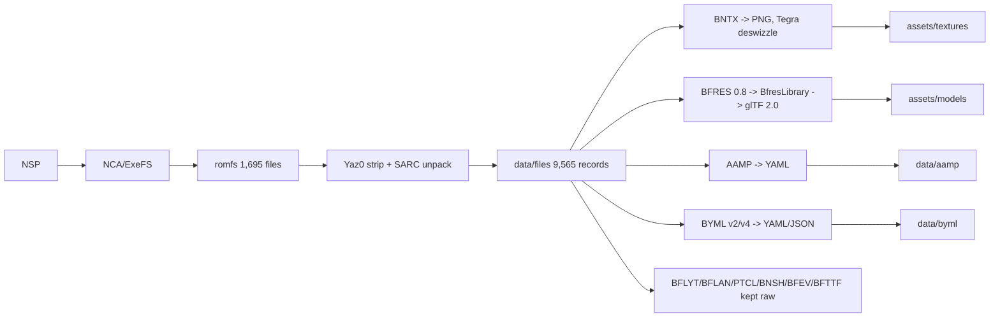

# GBG graphics & asset pipeline: design study (read-only)

Source: `D:\gbg\game-builder-garage\` (NSP extract, romfs 1,695 files). Read-only; no assets copied. Caveats from `REPORT.md`: BC4 exported grayscale, BC5 normals as RG, BC6H skies clipped to 8-bit, LOD>0 not exported, BFLYT/BFLAN/PTCL/BNSH/Phive not decoded.

Legend: **[V]** verified in dump files or by viewing PNG. **[I]** inference from names/structure, not confirmed at runtime.

## 0. TL;DR
- Style: bright, flat-ish, toy/paper-craft. Low-poly props, saturated 2-3 colour palettes, thick outlines are NOT in the models [V: contact sheet]. Editor is flat 2D vector-like UI with per-node-type coloured glyph bodies.
- Nodons: each node type has its own glyph body (`&`, hand, etc.) with a reusable face overlay set. Faces are texture swaps, not skeletal rigs [V: names, PNGs] [I: runtime switch logic].
- Asset load is huge texture-heavy UI (4,074 textures) and small 3D set (59 glTF). Most 3D effort is in props and environments, not characters.
- Lesson for an original builder: go for a flat 2D node/glyph system + a handful of stylised 3D props. Keep faces as layered sprites. Do not chase PBR.

## 1. Art direction

### 1.1 Visual style [V unless noted]
| Aspect | Evidence | Notes |
|---|---|---|
| 3D props | `models-contact-sheet.png` | Low poly, faceted, flat-to-soft shading. Props read at a glance (box, TV, fish, chest, ball). |
| Characters | `models-pose-check.png` | Plz_Player00 = blocky box-head robot. Plz_ObjC_Hiker02-09 = stylised humanoids with big hands, T-pose friendly. |
| Palette, props | contact sheet | Warm primaries (red, orange, yellow, blue), desaturated greys for neutral parts. |
| Sky | `textures/Model/Plz_Sky00_Noon.../PlzSky00_Vr_full.png` (3072x1536, BC6H) | Cartoon gradient: near-black zenith, cobalt band, cyan horizon glow, flat-ish white puffy clouds. |
| Lighting | `data/aamp/Env/*.baglenv.yml` (82 files) | Directional + hemisphere light per area, "Chara_Amb" hemisphere for characters, fog present in all 82 files. Time-of-day variants: noon, night, evening, underwater, dark. |
| Post | baglenv objects | BloomObj ~246 occurrences, DepthOfFieldObj ~258, OfxLensFlareRig ~136 (occurrence counts across files, not per-file). Lens-flare sprites in `textures/Env/` (29 textures). |

Default key light (`default.baglenv.yml`) [V]: DirectionalLight intensity 6.0, colour near white warm (1.0,1.0,0.85). Hemisphere sky (0.2,0.5,1.0) at 2.0; ground (0.3,0.3,0.4). Character hemisphere intensity 3.0 with warm ground (1.0,0.36,0.0).

### 1.2 Nodon character design [V: names + PNG view; I: intent]
- **Body = node glyph.** Node-type icon is the node's identity shape:
  - `AndNode` → green `&` glyph with blue/white face overlay (`Layout/Tpb_L_NodenBg_01/.../AndNode_Normal_SRGB^w.png`, `Model/Tpb_LgcEmo/.../AndNode_Face_Smile.png`).
  - `PlzHandNode` → pink hand with four fingers, eyes and an orange base (`Tpb_LgcEmo/.../PlzHandNode_Face_Smile.png`).
- **Face = reusable overlay.** Each node type has a set of face textures named `<NodeType>_<State>`:
  - Eyes: `EyeLeft_Default`, `EyeRight_Default`, `EyeLeftClose_Default`, `EyeRightClose_Default`.
  - Mouth: `Mouth_Default`, `Mouth_Talk`.
  - Composite: `Face_Default`, `Face_Smile`, `Face_Talk`, `Overlay_Talk`, `Overlay_Default`, `Normal`, `RawScale`, `Blink`, `Smile`.
  - Counts in index: Tpb_LgcEmo 696 entries, Tpb_LgcNodeCapture 174, Plz_ObjC_Hiker* ~32. Smile/Blink/Talk counted across ~87 node types.
- **Readability rules visible in the set** [I]:
  - Eyes are the largest face element, white sclera with blue/magenta iris and lid shapes.
  - Closed eyes are a separate texture, so blink = swap, not a rig.
  - Talk = mouth swap plus overlay. Smile = whole-face swap.
  - Mouth is a pink blob, bold silhouette at small size.
- **Colour coding.** Node body fill per category: `Tpb_NodenBg_Yellow_00`, `Tpb_NodenBg_FillYellow_00`, `Tpb_NodenBg_PuzzleColor_00`. Palette is bright, 1-2 accent colours per body.

### 1.3 UI style [V]
- Flat 2D, rounded rectangles, white-on-tint, thin dark outlines. Samples: `Layout/Tpb_L_PropertyWindowBase_00/.../Tpb_PropertyWindowFrame_00^w.png` (dark rounded frame), `Tpb_L_BgGrid_00/.../Tpb_GridLineincludeBold_64^s.png` (1-px grid lines, bold every 64 px).
- Icons: `Tpb_Btn*`, `Tpb_Ico*`, `Tpb_Axis_00..02` for plaza axis; `Tpb_btnStripe` for cursor highlight.
- Typography: BFTTF/BFOTF fonts (60 files, XOR-obfuscated TTF per REPORT). Glyph atlases in `textures/Font/` (8 files, up to 1024²). Multilingual: 13 languages in MSBT, no Vietnamese.

## 2. Asset inventory

### 2.1 Textures (`assets/textures/bntx-index.json`) [V]
- 4,074 entries, all `status: ok`. 4,090 PNG files on disk.
- Top-level split by index:
| Folder | Entries | Source files | Content |
|---|---|---|---|
| Model/ | 2,089 | 121 | 3D albedo/normal/AO/emissive/mask per model, face sets, node-type textures |
| Layout/ | 887 | 139 | UI widget atlases (Tpb_L_* and screens) |
| Pack/ | 887 | 139 | Same UI packs under `Pack/Cvr.pack.d/` (count match; exact path equality not verified) |
| Effect/ | 174 | 5 | Particle textures (`plz_glow_00`, `plz_flash`, `plz_smoke00`, `plz_lineflare`...) |
| Env/ | 29 | 2 | Lensflare, glare, hexagon, highlight |
| Font/ | 8 | 8 | Glyph atlases |

- Formats (raw Tegra format IDs): 0x1d01 (1,249), 0x2d06 (1,072), 0x1c06 (674), 0x0b01 (355), 0x0b06 (259), 0x1a06 (191), 0x1e02 (119), 0x1e01 (75). Mapping to BCn names not checked here.
- Mips: 1 mip for 1,844 entries, 8-11 mips for ~1,150 entries (3D albedo/normal, skies).
- Typical sizes: 128×128 (758 entries, most common), 512² (187), 256² (177), 32² (173), 1×1 (206, mostly white/fill placeholders). Large: sky 3072×1536 and 2048×1024; catball body albedo 2048²; container albedo 1229².
- Node-named textures: 1,211 distinct names contain "Node". This is the per-node-type texture set (icons, body, faces).

### 2.2 3D models [V]
| Item | Count / size |
|---|---|
| BFRES read | 132, 0 failed (REPORT) |
| Models with geometry | 49 hold models → 59 glTF (5 Lab_Joycon_L_Fix* empty in source) |
| glTF total | 59 files, 59 `.bin`, bin total ~40 MB |
| Meshes | 207 across glTF (LOD0 only) |
| Skins | 59 (one per glTF) |
| Skeletal animations | 316 across 35 models |
| Material anims | 33 `material-anims.json` files, 121 anims, 5,417 pattern frames |
| Skeleton JSON | 58 files (one glTF has no skeleton; count mismatch with 59 is unexplained) |
| Largest glTF | CvrHus_Catball 864 KB, Bzk_Zoo_Hippopotamus 644 KB |

Example: Plz_Player00 [V] = 5 meshes (Fist, Palm, Eye, Nose, PlayerBody), 1 skin, 21 animations: Wait, Walk, Run, JumpStart/Loop/End, mirror variants, ActionA-D (Start/Loop).

Empty-in-source models: Lab_Joycon_L_Fix00, Fix02, Fix03, Fix04, Fix05 (empty). Lab_Joycon_L_Fix06 and Fix01 have geometry.

### 2.3 Layout, effects, audio [V]
| Kind | Count | Status |
|---|---|---|
| BFLYT (layouts) | 340 | raw only, not decoded |
| BFLAN (layout anims) | 1,190 | raw only |
| Shader binaries BNSH | 20 | raw only |
| BFSHA (shader packs) | 49 | raw only |
| PTCL/VFXB (particles) | 5 | raw only; textures exported to Effect/ |
| BFEVFL (event flows) | 245 | raw only |
| BFTTF/BFOTF (fonts) | 60 | raw only (XOR-obfuscated) |
| AAMP params | 161 | YAML: Env 146, Grass 2, Layout 9, Shader 4 |
| BYML | 307 + 1,178 (dump note) | scene `.bscn` 20 |
| Audio | 5,592 WAV | not in scope |

Learn videos: 16 webm, 23 jpg (`data/files/Learn/`).

### 2.4 Typical sizes, summary
- UI atlas: 128² to 512² per texture, 1-10 small sheets per screen.
- 3D: 1-5 mesh parts per prop, 1-4 texture maps per part, 2048² max albedo.
- Sky: single 3072×1536 equirect.

## 3. Character and object rendering

### 3.1 Skinning and animation [V]
- Skin: up to 4 influences per vertex (converter logs `skin>4`; none seen per REPORT).
- Skeleton: skeleton JSON per model; bone counts not reliably extracted here.
- Skeletal anims are sampled at 60 fps (frame rate assumed by converter, not stored).
- Material animations: shader-param tracks (`kind: ShaderParam`), colour tracks, and texture-pattern tracks. Pattern tracks swap texture frames. Example: `Type_fsp`, `Type_fvm` shader-param groups on `Mt_Board`, `Mt_Pin`.
- glTF has no standard target for shader params, so material anims are JSON only.

### 3.2 Faces [V names; I behaviour]
- Nodon faces are not in the 59 glTF rigs. They are 2D texture overlays per node type (see §1.2).
- Plz_Player00 has separate `Mt_Eye` and `Mt_Nose` meshes (static parts).
- Blink/talk/smile likely driven by material-anim pattern tracks or by swapping textures in code [I, not verified: the BFLAN/BNSH layer that selects these is not decoded].

### 3.3 LOD [V]
- Only LOD0 exported. No LOD metadata used. LOD use unknown.

### 3.4 Objects the player places [I, partly V]
- `Plz_*` models are play-zone world objects. Primitive set: `Plz_Field01`–`Plz_Field05` = plane, cube, cylinder, hemisphere, sphere [V: contact sheet]. These look like the basic physical shapes for building.
- Characters for physics objects: Plz_ObjC_Hiker02–09 (humans), Plz_Player00 (robot).
- Props: Plz_Obj_TreasureBox, Plz_Obj_Balloon00, Plz_Obj_Hippopotamus, Plz_Car00, Plz_Drone00, Plz_RigidObj_Dice00, Plz_GolfBall00.
- Physics is separate: PlzRigidNode / Phive config in `data/byml/Phive`. Visual mesh is not the collider [I].

## 4. Editor visuals (node-graph screen)

Evidence is textures and layout names only. No layout (BFLYT) decoded, so placement is inferred.

| Element | Evidence | Confidence |
|---|---|---|
| Node body | `Tpb_L_NodenBg_00/01` (85 files each): one body per node type, e.g. AndNode_Normal_SRGB^w | V (names), I (use) |
| Body accents | `Tpb_NodenBodyUnderLine_00`, `Tpb_NodenBg_Yellow_00`, `Tpb_NodenBg_PuzzleColor_00` | V |
| Node icon/face | `Tpb_LgcEmo`, `Tpb_LgcNodeCapture` | V |
| Ports | `Port_BindToChild`, `Port_BindToChild_Background_1px/2px`, `Port_BindToChild_Background_In1px` (32 entries) | V names, I placement |
| Wire | logic file `002_Wire.c` exists; no wire texture identified | Unresolved |
| Property window | `Tpb_L_PropertyWindowBase_00`, `Tpb_L_PropertySlider_00`, `Tpb_L_PropertyNumpadView_00` | V |
| Grid | `Tpb_L_BgGrid_00` (64-px bold lines) | V |
| Cursor | `Tpb_L_Cursor`, `Tpb_L_SelectCursor_00/01`, `Tpb_btnStripe` | V |
| Balloons | `Tpb_L_Balloon_00`, `Tpb_L_BalloonImg_00` (chat/hint bubbles) | V |

Port indicators: the port set uses name suffixes like `_Background_1px` and `_In1px`, which hints at thin rings or stroke-only shapes. Exact look not seen.

## 5. Technical pipeline

| Stage | Tool / format | Status |
|---|---|---|
| Unpack | `unpack-romfs.py` | done, 0 errors |
| Textures | `decode-bntx.py` (texture2ddecoder, pillow) | 4,074 OK |
| Models | `BfresToGltf` (BfresLibrary, MIT, .NET 10) | 132/132 read; 59 glTF |
| Contact sheets | `render-gltf-sheet.py`, `render-gltf-pose.py` | done |
| Layouts | BFLYT/BFLAN | NOT decoded |
| Shaders | BNSH/BFSHA | NOT decoded |
| Effects | PTCL/VFXB | NOT decoded (textures only) |
| Event flows | BFEVFL | NOT decoded |
| Fonts | BFTTF/BFOTF | NOT decoded (XOR) |
| Physics | Phive | NOT decoded (config BYML only) |

Known loss: BC4 grayscale, BC5 normals as RG, BC6H sky tone-clipped to 8-bit. Re-export from raw if needed.

## 6. Lessons for an original game builder's art and rendering

### 6.1 Style targets (ranked by fit)
1. **Flat stylised 2D node UI + low-poly 3D props.** Matches what GBG does [V]. Cheap to make, reads well at small sizes, avoids PBR cost.
2. Full 3D everywhere with PBR. Rejected: costly art, weak readability at node scale.
3. Pure 2D sprites for props. Simpler but loses the "place objects in a 3D play space" feel.

### 6.2 Minimal asset set (YAGNI)
- **Node glyphs:** one body shape per category, not per node type. Colour-code by category. Per-node icon as a single glyph layer. Generate procedurally where possible.
- **Face overlay:** 4 layers (eyes open, eyes closed, mouth closed, mouth open). Blink = eyes swap. Talk = mouth swap. Smile = mouth layer swap. Covers GBG's behaviours with ~4 textures, not ~9 per node.
- **Props:** 5 primitives (plane, cube, sphere, cylinder, hemisphere) + 10-20 hand-made props. Mirrors `Plz_Field01-05` plus a few character types.
- **Sky:** one gradient sky + cloud sprite set, no equirect HDR required.
- **Effects:** 6-8 soft sprites (glow, flash, smoke, line flare). GBG uses ~174 effect textures; that is overkill for v1.
- **UI:** one atlas per screen, 128-512 px, 1px grid, rounded frame, 3-4 icon sets.

### 6.3 Tech choices (rank, with trade-offs)
Verification note: the ranking below is from general engineering knowledge; no external sources were fetched in this study.

| Rank | Option | Fit | Pros | Cons | Adoption risk |
|---|---|---|---|---|---|
| 1 | Web: TypeScript + Canvas2D/SVG (editor) + three.js (3D props) | High if web target is acceptable | Graph UI easy, glTF loader mature, fast iteration | No console target; WebGL perf ceiling | Low: mature libs |
| 2 | Godot 4 (GDScript or C#) | High for standalone desktop/console-ish | 2D+3D, free, good export; node UI via Control nodes | Smaller ecosystem for node UIs | Low-medium |
| 3 | Unity | Medium | Huge ecosystem | Overkill for flat style; licence/cost change history | Medium |

Pick: **Web (TypeScript + Canvas2D/SVG + three.js)** if the target is browser or mobile-web. **Godot 4** if the target is standalone desktop. Decision depends on platform, which is not in the user's brief.

### 6.4 Pitfalls
- Do not copy GBG's node-face count. ~9 face states per node × 90 nodes = ~800 textures. Use layers.
- Texture-name-driven pipelines (e.g. `<Node>_<State>`) become unmaintainable. Use a state enum + layers.
- Skeleton for faces is overkill. Swap textures or small mesh deforms.
- Sky: avoid BC6H-style HDR unless you need it. An 8-bit gradient is enough.
- Keep the LOD question open: GBG exports LOD0 only, so you don't know its LOD strategy from this dump.
- Lighting presets: 82 env files is a lot. Start with 3-4 presets (day, night, underwater, dark) and per-area tints.

## 7. Limitations of this study
- No runtime observation. Face state switching, blink timing, pattern-track playback and wire rendering are inferred.
- BFLYT/BFLAN/PTCL/BNSH not decoded. Editor layout and effect look are partly inferred from names.
- Only ~8 PNGs viewed by eye. Palette numbers are approximate. No colour histogram run.
- Skeleton count (58) vs glTF count (59) mismatch unexplained.
- Pack vs Layout texture equality only checked by count, not by path.
- Tech ranking unsourced (no WebFetch/WebSearch run). Treat as opinion, not evidence.

## 8. Unresolved questions
- Which material-anim tracks drive blink/talk/smile at runtime? Needs BFLAN/BNSH decode or emulator capture.
- Is the wire drawn as a texture, shader, or procedural line? No wire texture found.
- Which model is the Nodon's base body, if any? Only the 2D glyph+face set was identified. No 3D Nodon mesh was clearly found.
- Are `Plz_Field01-05` the in-game placeable primitives? Inferred from shape and naming only.
- Why 58 skeleton files vs 59 glTF?
- Platform target for the original game (web, desktop, mobile) decides the tech pick.

Status: DONE_WITH_CONCERNS
Summary: GBG art = flat stylised UI with per-node-type glyph bodies plus texture-swap faces; 3D is a small low-poly prop set with skeletal and material/pattern anims. Report written to D:\workspace\GameBuilder\plans\reports\researcher-261027-gbg-graphics.md.
Concerns/Blockers: Layout, shader, and effect layers are undecoded, so editor and face-switch behaviour are inferred. Tech ranking is not source-backed. Two count mismatches (skeleton 58 vs 59, Pack vs Layout path equality) are unresolved.
