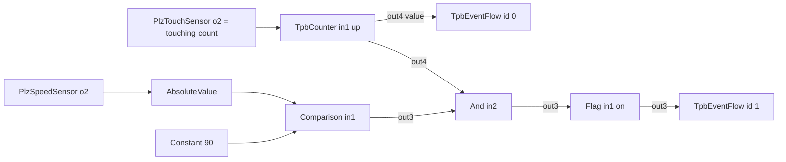
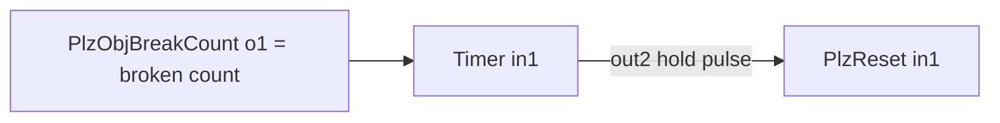
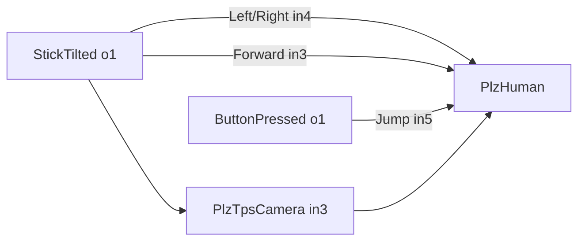

# GBG "Nodon" logic/runtime study (design input, not a clone spec)

Date: 2026-10-27 · Source: `D:\gbg\game-builder-garage\` (read-only extract, read-only use) · Scope: logic/runtime only
Tags: **[V]** verified in code or data (file cited) · **[I]** inference · **[U]** unresolved
Confidence: runtime code is pseudo-C from Ghidra (names annotated by the dump author). BYML field names are CRC-inferred (REPORT caveat 1). Facts about *semantics* below come from reading code bodies, not from field names.

---

## 0. TL;DR

- Nodon = typed actor node. Every signal is one **float32**. Bool = 0.0/1.0. "Off" = |x| <= 1e-4 **[V]**.
- Evaluation is **synchronous push**: a node that changes its output pushes the new (value, kind, frame) into its downstream links right away and recurses. Cutoff = same value AND same kind. **[V]** (code 0x7c62c0 / 0x7c66d0). Zero frame latency through pure-logic chains **[I]**.
- Per-frame work only happens in **tick** slot (sources, timers, physics actors). Logic nodes react to input pushes. **[V]** for slots, **[U]** for global tick order.
- Cycles are legal in the data but almost absent: **1 of 436** non-empty programs has a cycle, and it runs through a physics actor. **[V]**
- Graph file = JSON-like (BYML in the game): nodes {id,type,props,label}, connections {id, from{node,port}, to{node,port}}. Ids share one counter, step 10. **[V]**
- Shipped programs are mostly small (median 4–20 nodes), built from ~15 primitives (sensors, stick/button, constant, comparison, counter, flag, timer, and/not, calc, mapping, event-flow, reset) wired into a small number of actor controllers and object nodes.

---

## 1. Taxonomy

### 1.1 Type registry
- 196-entry enum (`logic/node-type-enum.json`), index = actorType **[V]**.
- 91 types go through the factory (rva 0x7dd2c0) in this build; 105 are Labo Toy-Con / other-game types (Mtr*, Robot*, Bike*, Fish*, House*, Cvr*, ...) that this game's programs never use **[V]** (README "Coverage").
- **90 types appear in shipped programs** (`NODON-SPEC.md`). 88 have code; PlzStartPosition and PlzUseGyroCamera are cut from this build **[V]**.

### 1.2 Categories of the 90 used types
Grouping is mine **[I]**; type names and port labels are from the spec.

| Category | n | Members (short) | Role |
|---|---|---|---|
| Device input | 9 | StickTilted, ButtonPressed, TouchPosition, IsTouch, FoundIrMarker, IntegratedAxisAngle, IntegratedSurfaceUpward, IntegratedSwinged, IntegratedRotationSpeed | Read controller/console, emit a number or bool |
| Device output | 8 | Vibrate, EmitIrLed, Gauge, Spoit, Move2d, AlwaysOn, TpbPlaySound, TpbPlayBgm | Consume a signal, drive hardware or HUD/audio |
| Logic (state) | 7 | And, Not, Flag, Timer, Trigger, TpbCounter, IntegerRandom | Boolean and stateful edge/latch/delay/accumulate |
| Math | 11 | Constant, Comparison, Calculation, Mapping, AbsoluteValue, Negation, SquareRoot, Trigonometric, Atan, Quantization, AngleDistance | Pure value transforms |
| Flow/meta | 6 | OnStart, Comment, TpbEventFlow, TpbPuzzleClear, WireWarpIn, WireWarpOut | Start pulse, notes, named event bus, goal, teleport-wire pair |
| World state | 6 | PlzFieldConfig, PlzReset, PlzPlaySpeed, PlzExit, PlzChangeFile, PlzGravity | Global game-state commands |
| Object sensor | 10 | PlzTouchSensor, PlzObjBreakCount, PlzPositionSensor, PlzSpeedSensor, PlzAngleSensor, PlzRotationSensor, PlzBreakSensor, PlzBrokenSensor, PlzAccelerationSensor, PlzGrabSensor | Read physics-world state of targets |
| Object body | 7 | PlzRigid (1526 uses), PlzFancyRigid, PlzScoreRigid, PlzMoveRigid, PlzRotateRigid, PlzStretchRigid, PlzCommentRigid | Physical objects; same family, differing behaviour/params |
| Joint/force | 5 | PlzJointSingleAxisSlider, PlzJointHinge, PlzJointSlider, PlzRope, PlzPullForce | Constraints between bodies |
| Actor control | 6 | PlzHuman, PlzCar, PlzUfo, PlzHand, PlzHead, PlzBindCommander | Character/vehicle with named input ports (Forward, Left/Right, Jump, Action...) |
| Camera | 6 | PlzEasyCamera, PlzTpsCamera, PlzCameraLookAt, PlzCameraViewAngle, PlzCameraPosition, PlzCameraDirection | Camera control |
| Spawn | 3 | PlzGenerator, PlzGeneratorFew (1), PlzGeneratorMany (100) | Spawn objects on trigger |
| Object warp | 2 | PlzObjWarpEnter, PlzObjWarpExit | Teleport objects (channel pair) |
| Look | 2 | PlzIntegratedEffect, PlzTexture | Visual effects/material |
| Unknown/cut | 2 | PlzStartPosition, PlzUseGyroCamera | No code path in this build |

Sum = 90 **[V]** (counts above). Most-used: PlzRigid 1526 instances / 193 programs; StickTilted 379 / 204; Constant 297 / 174.

### 1.3 Design observation
- Seven near-identical object nodes (Rigid family) and three generator nodes (1/10/100 objects) **[V]**. Variants differ by parameter block, not by behaviour class. This is the clearest YAGNI signal in the dump (see §6).
- Labo Toy-Con types (105) share the same factory and enum: the game is a multi-title engine; the Nodon set is a superset of this game's need **[V]**.

---

## 2. Signal model

### 2.1 Value and port types
| Aspect | Finding | Tag |
|---|---|---|
| Runtime value type | one 32-bit float per output (+0x268 on the node) | V |
| Bool | 1.0 (0x3f800000) = on, 0.0 = off; logic nodes emit only these | V (And, Not, Comparison, Flag) |
| "Off" test | `-0.0001 <= x <= 0.0001` (helper 0x724ce0) | V (`untagged/0700000.c`) |
| Truthiness | any non-off value counts as on, numbers included (And reads raw values) | V |
| Port types | none at runtime; a port takes a float. Editor-side labels only | V (spec "port label") |
| Non-float runtime data | enums, ints, vec3, u64 bitmasks live in **props**, not on wires | V (props-map.json) |
| Strings | labels/memos only, never on a wire | V |

### 2.2 Continuous vs pulse
- No dedicated "pulse" type. Pulses are *derived* by state nodes:
  - **Trigger** (168): output 1 on rising edge (prev off → now on); stores prev in node+0x30c **[V]**.
  - **Timer** (35): rising edge → hold output 1 for N frames **[V]**.
  - **OnStart** (91): emits an on-start tick **[V, by tick slot]**.
- Analog values pass through unchanged (StickTilted, Constant, Calculation, Mapping). **[V]**

### 2.3 Signal kind (second tag on every value)
Each output carries a **kind** (int 0/1/2) next to the value (+0x274) **[V]**. Observed use:

| Producer | kind emitted | Tag |
|---|---|---|
| Constant | 2 | V (0x570d90 → setter with 2) |
| ButtonPressed, StickTilted | 2 | V |
| Timer output | 1 | V |
| Trigger, Not | pass-through of input kind | V |
| And, Comparison, Calculation, Flag | merge/table of input kinds | V |
| Any node when halted | 2 (value 0) | V (Flag, Counter) |

Merge rule, decoded from the static 3×3 table at 0x846b20 (initialiser values read from the decompile):

| in1 \ in2 | 0 | 1 | 2 |
|---|---|---|---|
| 0 | 0 | 0 | 0 |
| 1 | 0 | 1 | 1 |
| 2 | 0 | 1 | 2 |

- Merge (0x746cc0) used by most binary nodes: if either input is 2, result is 1; else table. So merge(1,1)=1, merge(1,0)=0, merge(2,x)=1.
- Raw table (0x746b20, node+9 flag set) used by Flag, Counter: returns the table value unchanged, so 2 survives.
- Kind 0 behaviour: Flag treats a kind-0 input as **off regardless of value** (034_FlagNode.c). EventFlow sends payload 0 for kind 0. **[V]**
- Interpretation: 0 = "no signal / unset", 1 = "computed or timed", 2 = "source or neutral". **[I]** Only the kind-0 meaning is verified. **[U]** what kinds 1 vs 2 mean to the player.

### 2.4 How values flow (zero-level detail)
```mermaid
sequenceDiagram
  participant Src as Source node (tick)
  participant Lnk as Link (Wire actor, type 2)
  participant Dst as Downstream node
  Src->>Src: new value v, kind k, frame f
  Src->>Lnk: write v,k,f to each outgoing link
  Lnk->>Dst: call slot 0 (evaluate)
  Dst->>Dst: compute out'; node_set_output(out', kind')
  Dst-->>Lnk: propagate recursively if changed
```
- Setter 0x7c66d0 stores value, frame (+0x270, from global frame counter at manager +0x114), kind (+0x274), then calls propagate 0x7c62c0 **[V]**.
- Propagate short-circuit: if value equal AND kind equal, stop **[V]**. This is the only cycle guard visible.
- Links: each output has a fan-out count (+0x9f0) and array (+0x9f8); link objects carry a copy of value/kind **[I]** (layout partly inferred from field use in 0x7c62c0 and Trigger/Timer code).

### 2.5 Fan-in and fan-out
- Fan-out: many (max observed 5 per output port) **[V]**.
- Fan-in: logic nodes read one source per port (`vf_input`, `vf_input_a/b`) **[V]**.
- **Fan-in conflict [V data]:** 102 input-port instances in the shipped programs have 2+ sources (e.g. PlzHuman in1 ×38, Timer in1 ×6, Not in1 ×4, Flag in1 ×1, EventFlow in1 ×5). Examples: `Lesson/Lesson_2DAction_03.json`, `Guidebook/Guidebook_Connection_system00.json` (EventFlow in1 from two AbsoluteValue outputs).
- **[U]** How multi-source inputs resolve at runtime (last-write, OR, per-link). The data shows the editor allows it; the logic nodes read one `vf_input`.

---

## 3. Evaluation model

### 3.1 Lifecycle (per node, from delegate slots)
| Slot (actor offset) | Role | Tag |
|---|---|---|
| +0x68 tick | per-frame update; sources (Stick, Button, Constant, Timer countdown, Touch-position, Human/Car/Ufo, OnStart, Comment) | V (slot), I (per-frame call site) |
| +0xa0 / +0xc0 evaluate | runs on input push; computes output | V |
| +0xe0 reset | clears state (Flag +0x30c, Counter value, Timer, Random) | V |
| +0x230 label | UI text only | V |
| +0x1f8 common | Appear/appear hook shared by all LogiCon nodes | V |

- **[U]** Who calls tick each frame and in what order vs. physics. Not located in this pass (no direct tick caller found in game/untagged; scan limited by instruction).
- Halt: global flag (manager +0x136). When halted, logic nodes emit 0 with kind 2 (Flag, Counter, Trigger) and Timer passes its input through the "halt" helper; Stick returns 0 **[V]**.
- Frame: global int (manager +0x114) stamps each write **[V]**. Timer uses it only through helpers. Timing is in seconds converted with 60 Hz **[V]**.

### 3.2 Per-frame order
1. Tick every source/stateful node (order unknown **[U]**).
2. Each source write calls propagate; downstream logic re-evaluates immediately (depth-first) **[V for propagate, I for "immediate"]**.
3. Physics body nodes update in the physics step **[I]**; their sensor outputs enter the graph whenever their tick/propagate fires **[U]**.

### 3.3 Latency
| Path | Latency | Tag |
|---|---|---|
| Logic chain (And → Flag → EventFlow) | 0 frames | I (synchronous push) |
| Source tick → consumer | same frame, if source ticks first | U (order) |
| Timer delay | round/ceil(sec × 60) frames | V (see §3.5 correction) |
| Counter accumulate | depends on evaluation count | U (see §3.6) |

### 3.4 Cycles and feedback
- Data: 1 cyclic program out of 436 non-empty (`Guidebook/Guidebook_FallAndBreak_00.json`). Loop: PlzHuman out1 → PositionSensor → Comparison → BindCommander → PlzHuman in1 **[V]**. It runs through a physics actor, not pure logic.
- Runtime: no iteration cap or topological sort visible. Termination relies on the equal-value short-circuit **[V]**. An oscillating loop with changing values would recurse forever **[I]**.
- Design takeaway: feedback is rare in practice; the engine has no guard beyond equality.

### 3.5 Timer correction vs REPORT/README
- README says "round(s × 60)". The helper at rva 0x725e50 (`untagged/0700000.c`) returns `ceil` for non-negative non-integers and truncation otherwise. **[V]** Correct statement: ceil for positives.
- Timer state: int at node+0x308. Positive = delay countdown, negative = hold countdown, zero = idle **[V]**.

### 3.6 Counter (TpbCounter, 190) — partial
- Inputs: 1 count-up, 2 count-down, 3 reset (priority), 4 output value **[V]**.
- Reset → value := ints[3] **[V]**. Halt → value := ints[3], kind 2 **[V]**.
- Otherwise: reads input values (not only edges), clamps with ±1e6 **[V]**; ignores values outside [-1, 1] **[V, from branch shape]**; mode enum (1/2/3) selects different clamp/wrap helpers **[U, not read]**.
- Evaluated only on input push (no tick slot) **[V]**. So its accumulation depends on how often inputs change **[I]**. This is a design trap (see §6).

### 3.7 Determinism
- Float32 math with NaN/Inf guards (Calc: NaN→0, Inf→1.0; Comparison: NaN/Inf→0; Sqrt: x<=0→0) **[V]**.
- Comparison "equal" uses FLT_EPSILON (~1.19e-7) while "off" uses 1e-4. Two tolerances in one graph **[V]**.
- RNG only in IntegerRandom; seed/source not checked **[U]**.
- Physics (Havok) is a second source of non-determinism unless fixed-step **[I]**.

---

## 4. Graph data format

### 4.1 Program file (JSON view; BYML in the game)
```
program: "<path>"
meta:   format_version, next_id, node_count, editor_zoom, editor_view_pos,
        created_at / updated_at, title, memos_a/memos_b, palette colours, ...
nodes[]:
  id          int (step 10 in 436/436 non-empty programs)
  type        string (enum name, e.g. "TimerNode")
  label       {en, ja} (null for logic nodes)
  editor_pos, editor_size   (layout only)
  props       { ints[], enums[], floats[], vec3s[], u64s[] }   (omitted when empty)
connections[]:
  id          int (same id space as nodes)
  from        { node, type, port_index }   (output port, 1-based)
  to          { node, type, port_index }   (input port, 1-based)
```
Verified: `node_count == len(nodes)` in 436/436 **[V]**.

### 4.2 Props block
- Five typed lists, keyed by offset in the runtime param block **[V, props-map.json]**:
  - `ints` (S32), `enums` (U32), `floats` (F32), `vec3s`, `u64s` (target masks).
- Defaults are omitted: entries may be `null` inside a list; trailing defaults dropped **[V]**. Example: `ints: [null, 6, 6]`.
- Target bitmask u64: bit i = target i (0 Field, 1 Box, ..., 41 BindCommander label) **[V, README]**.

### 4.3 Ports
- Port index is the label number (1-based) per node type **[V]**. Example: Comparison 1 Input 1, 2 Input 2, 3 Result. Counter 1 Count up, 2 Count down, 3 Reset, 4 Count.
- A port is identified by (node id, port_index). No separate port id in the JSON view. REPORT claims "port id = node id + port index" for BYML **[U, not checkable here]**.
- Max port index per type observed: Human 6, Joint slider 5, Ufo 5, Counter 4 **[V]**.
- Many object-node ports have blank labels in the spec **[V]**.

### 4.4 Limits seen (observed, not documented)
| Item | Observed max | Tag |
|---|---|---|
| Nodes per program | 88 (all-node catalogue sheet); 80 in a lesson | V (observed); cap **[U]** |
| Connections per program | 53 | V |
| Fan-out per output port | 5 | V |
| Warp channel | 0–26 (27 channels) | V (ints[0] range) |
| Event id | 0–25 (26 ids) | V (ints[0] range on EventFlow) |
| Counter clamp | ±1e6 | V |
| Format versions in use | 15–25 | V (see §8 discrepancy) |

### 4.5 Sheets and runtime-only objects
- Connection objects (Wire actors, type 2) exist at runtime, created per link, with two endpoints. They are **not** saved: 0 of 467 programs contain a Wire node **[V]**.
- Multi-sheet programs: `Lesson_2DAction_04.json` (main, 18 nodes) plus `_system00..03` (3–15 nodes each). Naming suggests secondary graphs per stage **[I]**. No explicit cross-sheet link found in data **[U]**.
- Event bus: TpbEventFlow with int id; receiver side not traced **[U]**.
- Warp pair: entrance and exit share the same channel int; 63/66 programs with warps have matching channel sets **[V]**. Pairing rule in runtime is via a separate delegate (slot 0xa40) **[I]**.

---

## 5. Shipped program patterns

### 5.1 Corpus stats [V]
- 467 program files: Lesson 192, Puzzle 82, Guidebook 135, Ending 28, Param/ 29, catalogue sheets 2 (one full all-node sheet with 88 nodes and 0 connections). 3 files parse with zero nodes.
- 6,868 node instances, 3,266 connections. 339 of 436 non-empty programs contain at least one logic-category node.
- Median nodes per program: Lesson 9, Puzzle 20, Guidebook 4, Ending 3. Largest real program: 79 nodes, 53 connections.

### 5.2 Most common port-level edges [V]
| Count | Edge (source out → dest in) |
|---|---|
| 121 | StickTilted.o1 → PlzHuman.i4 (Left/Right) |
| 107 | Constant.o1 → Comparison.i2 (threshold) |
| 85 | TpbCounter.o4 → Comparison.i1 |
| 66 | ButtonPressed.o1 → PlzHuman.i5 (Jump) |
| 65 | Flag.o3 → TpbEventFlow.i1 |
| 56 | PlzObjBreakCount.o1 → TpbPuzzleClear.i1 |
| 54 | Timer.o2 → PlzReset.i1 |
| 52 | PlzTouchSensor.o2 → Flag.i1 |

### 5.3 Most common 3-node chains [V]
- StickTilted > PlzTpsCamera > PlzHuman (52): camera-relative move.
- PlzObjBreakCount > Timer > PlzReset (42): delayed retry.
- Constant > Comparison > PlzBindCommander (41): threshold gate drives an actor.
- Constant > Comparison > TpbEventFlow (36): threshold → event.
- StickTilted > Calculation > TpbCounter (36): scaled input accumulates.
- TpbCounter > Comparison > AND (32): counted goal.

### 5.4 Three concrete patterns

**Pattern A: "Count to N, then latch and emit" (Lesson_2DAction_04_system01)** [V, dot+json]

Reading: counter gives a number, comparison makes a bool, And joins two conditions, Flag latches the result, EventFlow publishes. No timer, no tick logic.

**Pattern B: "Break → wait → reset" (42 chains)** [V, stat]

Timer provides delay and hold; reset input restarts the level. Sample: `Lesson/Lesson_2DAction_04.json` contains PlzObjBreakCount + Timer + PlzReset.

**Pattern C: "Input mapping onto an actor" (121 + 66 + 52 edges)** [V, stat]

Stick and button emit raw values; the actor's named ports (Forward, Left/Right, Jump, Action) are the only command surface. Camera is a separate node that feeds the actor.

### 5.5 Common composition rules [I]
- Sensors (Plz*Sensor, Touch) and device nodes are the only "world-reading" sources; state nodes (Flag, Counter, Timer) hold memory; EventFlow and Puzzle-Clear are the only "goal" sinks.
- Thresholds are always a Constant on one comparison input. No dedicated "greater than constant" node.
- Actor nodes have many named ports; logic reaches them through one or two wires.

---

## 6. Lessons for an original node-based builder

### 6.1 Ranked adopt list
| Rank | Adopt | Why | Risk if skipped |
|---|---|---|---|
| 1 | **Small primitive set**: Trigger (edge), Flag (latch), Timer (delay+hold), Counter, And, Not, Comparison, Constant, Calc, Mapping | Covers ~all shipped patterns. Composable. | Feature creep (90 types) and per-variant nodes |
| 2 | **One float signal + explicit "no signal" state** | Only kind-0 is load-bearing (Flag/EventFlow). Makes "not connected / not driven" separate from 0 | Confusing "0 means both off and unset" |
| 3 | **Named channels** for cross-sheet messaging (event IDs, warp channels) | Cuts wires (63/66 warp programs) | Spaghetti across large stages |
| 4 | **Global halt + per-node reset** for retry/restart | Clean lifecycle; fixes "stale latch" after retry | Ghost state after restart |
| 5 | **Versioned file format with per-field defaults omitted** | Loader tolerates 11 format versions and missing props | Hard migrations |

### 6.2 Ranked simplifications
| Rank | Simplify | Reason |
|---|---|---|
| 1 | Replace 7 object-body node types with one node + mode enum | Same behaviour family; YAGNI |
| 2 | Drop Wire-as-actor; store connections as plain edges | Runtime-only objects add lifecycle code; no saved trace |
| 3 | Drop the 3-value kind lattice unless you need it | Table is hard to explain; only kind-0 matters in shipped code |
| 4 | Forbid or explicitly merge multi-source inputs (add an OR node) | Data shows 102 cases; runtime behaviour undocumented |

### 6.3 Ranked pitfalls
| Rank | Pitfall | Evidence |
|---|---|---|
| 1 | **Unbounded recursion on cycles** (only equality guard) | Runtime code; 1 cyclic program |
| 2 | **Stateful nodes that accumulate on input push** (Counter) make results depend on evaluation count | Counter evaluate-only path |
| 3 | **Two tolerances** (off 1e-4, equal FLT_EPSILON) | Comparison vs off helper |
| 4 | **Silent NaN/Inf fallbacks** (Calc Inf → 1.0; Comparison → 0) hide errors from the player | Calc/Comparison code |
| 5 | **Blank port labels** on object nodes | Spec: most Plz object ports unlabeled |
| 6 | **Floats as bools without type check** lets numbers feed And/Not silently | And reads raw values |
| 7 | **Name collisions** (BindCommander labelled "Destroy Object") | Spec label vs name |

### 6.4 Architectural trade-offs (ranked for an original builder)
| Option | Pros | Cons | Ranking |
|---|---|---|---|
| A. Per-frame topological pass, back-edges delayed one frame | Deterministic; bounded; easy to debug; cycles become explicit | One frame of latency on cycles; needs sort | **1 (recommend)** |
| B. Push-synchronous with equality guard (GBG) | Zero latency; simple code | Unbounded recursion risk; order-dependent state | 2 |
| C. Event queue with dedupe per frame | Clear ordering; handles bursts | More code; latency = queue depth | 3 |

Adoption risk: GBG's push model is proven in shipped play, but the dump shows it relies on acyclic authoring by convention. For your own builder the risk is in player-authored cycles, which GBG rarely produces (1/436). Option A removes that risk for a modest cost.

### 6.5 Recommended core for your builder (ranked)
1. Float signal + typed ports checked at connect time (bool / number / event). Truthiness = nonzero, not epsilon.
2. Per-frame topological evaluation; delay back-edges by one frame; surface cycles in the editor.
3. Primitives: Constant, Compare, Calc, Not, And, Or, Trigger, Latch(Flag), Timer, Counter, Mapping, EventSend/Receive.
4. Global reset/restart; per-node reset hook; no implicit state across restart.
5. Versioned file with omitted defaults; every port labelled.

---

## 7. Evidence index (paths)

| Topic | File |
|---|---|
| Node registry | `logic/node-type-enum.json` |
| Type behaviour and ports | `logic/nodon-behaviour/NODON-SPEC.md`, `README.md`, `props-map.json` |
| Wire creation | `logic/nodon-behaviour/002_Wire.c` |
| And/Not/Flag/Timer/Trigger/Counter/EventFlow | `logic/nodon-behaviour/032_AndNode.c`, `033_NotNode.c`, `034_FlagNode.c`, `035_TimerNode.c`, `168_TriggerNode.c`, `190_TpbCounterNode.c`, `185_TpbEventFlowNode.c` |
| Calc/Comparison/Constant/Stick/Button | `logic/nodon-behaviour/068_CalculationNode.c`, `167_ComparisonNode.c`, `150_ConstantNode.c`, `019_StickTiltedNode.c`, `024_ButtonPressedNode.c` |
| Value/kind setter and propagation | `code/decompiled/untagged/0700000.c` (rva 0x7c66d0, 0x7c62c0, 0x7c6750) |
| Off, clamp, seconds-to-frames helpers | `code/decompiled/untagged/0700000.c` (rva 0x724ce0, 0x724e30, 0x725e50) |
| Kind merge tables | `code/decompiled/untagged/0700000.c` (rva 0x746b20, 0x746bb0, 0x746cc0) |
| Frame counter, halt flag | `code/decompiled/untagged/0800000.c` (rva 0x868330 frame; halt rva 0x86b0d0) |
| Program corpus | `logic/nodon-programs/Pack/Cvr.pack.d/Param/{Lesson,Puzzle,Guidebook,Ending}/*.json` and `.dot` |
| Cycle example | `logic/nodon-programs/Pack/Cvr.pack.d/Param/Guidebook/Guidebook_FallAndBreak_00.json` |
| Multi-source example | `logic/nodon-programs/Pack/Cvr.pack.d/Param/Guidebook/Guidebook_Connection_system00.json` |
| Pattern A example | `logic/nodon-programs/Pack/Cvr.pack.d/Param/Lesson/Lesson_2DAction_04_system01.json` (+ `.dot`) |
| Pattern B example | `logic/nodon-programs/Pack/Cvr.pack.d/Param/Lesson/Lesson_2DAction_04.json` |
| All-node catalogue | `logic/nodon-programs/Pack/Cvr.pack.d/Param/Tpb_Lgc_AllNoden.json` |
| Dump index | `logic/nodon-programs/nodon-programs-index.json` |

Analysis scripts (graph statistics, motif counts, multi-source check) live in the scratchpad, not in the dump.

---

## 8. Discrepancies found in the dump (must fix before reuse)

| Claim | Source | What the data shows | Tag |
|---|---|---|---|
| `format_version` constant 25 in 467/467 | `nodon-programs-index.json` | 438 files carry it; values 15–25; 25 only in 282 | V |
| `next_id` greater than every id | `nodon-programs-index.json` | equal to max id in 285/436; greater in 151 — it is the last issued id | V |
| Timer uses round(s × 60) | `README.md` | helper uses ceil for non-negative non-integers | V |
| 472 programs (5 empty) | `REPORT.md` | 467 program files; 3 with zero nodes (2 catalogue duplicates) | V |
| "Signal kinds 0/1/2 not settled" | `README.md` | Merge tables decoded (§2.3); kind-0 meaning verified | V |

Node count and connection id scheme (step 10) match the dump claims.

---

## 9. Limitations

- No runtime observation. Emulator and console firmware not available (REPORT "Not done"). All timing and order claims are static.
- Ghidra pseudo-C; some functions only partially read (Counter mode branches, Mapping, Quantization, IntegerRandom, Calc divide edge).
- Global tick scheduler not located. Relative order of source ticks, physics steps, and logic evaluation is unknown.
- Field names inferred from CRC32 (REPORT caveat 1). Behavioural claims rely on code bodies, not names.
- Multi-source input behaviour not resolved.
- No Labo Toy-Con or other-game nodes analysed beyond the enum.
- Corpus is the shipped set (467), not user-authored programs; patterns reflect tutorials and puzzles, not free play.

## 10. Unresolved questions
1. How do multiple sources into one input resolve at runtime (last write, OR, or per-link)?
2. Who calls the per-frame tick, and in what order relative to physics and logic propagation?
3. What do signal kinds 1 and 2 mean to the player-facing rules, and are they needed?
4. Counter mode 1/2/3 semantics (clamp, wrap, rate) and the exact per-evaluation formula.
5. Does the editor-side "warp channel" pairing run through the 0xa40 delegate as assumed?
6. Is the RNG seeded per program or per session?
7. Is there a hard cap on nodes or connections per program? (Only observed maxima: 88 nodes, 53 connections.)
8. How cross-sheet (`_systemNN`) graphs communicate beyond event ids.
9. PlzBindCommander's real purpose (name vs label "Destroy Object").
10. Meaning of enums[4] "has value" flag in Plz nodes (README: unknown).

Status: DONE_WITH_CONCERNS
Summary: GBG logic is a float-only, kind-tagged, synchronous push graph with a small primitive set; the core is clear and verified, but multi-source inputs, tick order, and Counter semantics remain unresolved, and the dump's format_version and next_id claims are wrong.
Concerns/Blockers: Analysis is static (no runtime). Ghidra names were annotated by the dump author; field names are CRC-inferred. Report is written to `D:\workspace\GameBuilder\plans\reports\researcher-261027-gbg-logic-nodon.md` (path given by the user; differs from the hook's default naming pattern).
